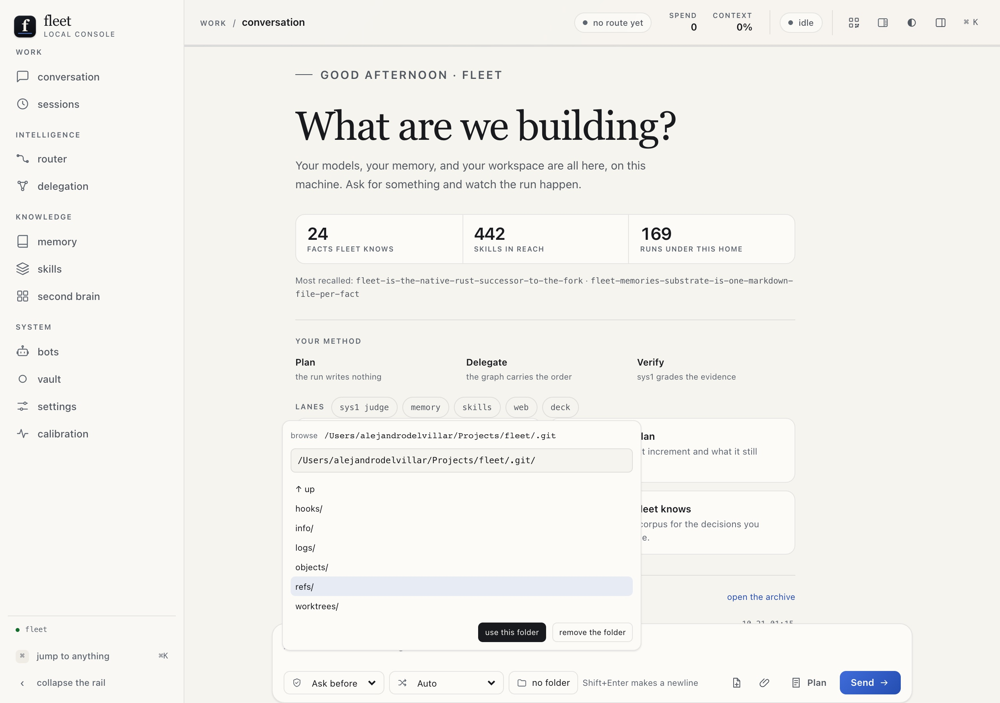
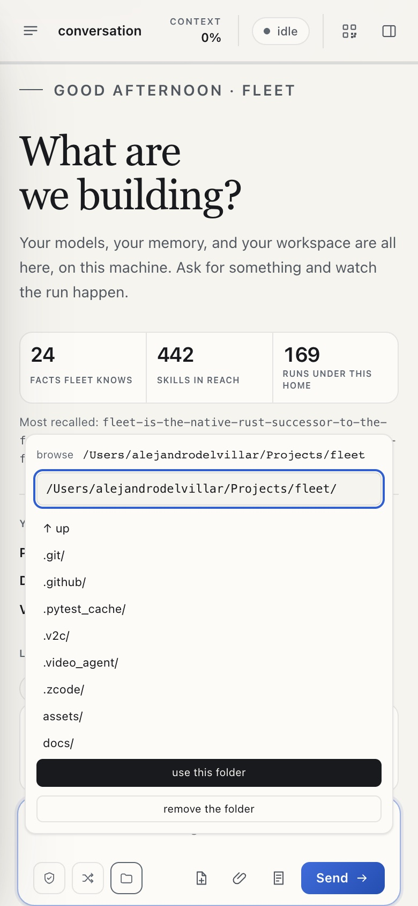

# Functional specifications

This file is the project's user-facing behavior reference, written in
the product's terms: what each surface is for, what you do there, and
what Fleet tells you when. It aggregates the existing sources —
[docs/architecture/surfaces.md](docs/architecture/surfaces.md) (the what
and why of every destination), the `docs/features/*.md` files (the how),
and the surfaces' own copy. When behavior changes, follow the feature
doc first and re-aggregate here.

If a command or surface has no entry here, it is either covered in a
feature doc or missing; the last section names the gaps as a backlog.

## What Fleet is for

Fleet is a coding agent that runs on your machine, under your own keys,
inside the folder you point it at. You ask for something; it plans,
acts with tools, verifies, and reports — and everything it did is in a
session log you can read, replay, and search. It remembers what it
learned across sessions, delegates the work that decomposes, schedules
what repeats, and routes each piece of work to the model your plans
already pay for. The language model speaks last: five specialized
services decide, measure, index, and render before it
([docs/architecture/lanes.md](docs/architecture/lanes.md)).

## The surfaces

Eleven destinations in four groups, one flat level, reachable from the
rail or the ⌘K palette. Every destination shares the grammar: a
one-sentence purpose, an identity card with **ask** buttons, a strip of
counts, a column of substance, and a rail of secondary reads. The ask
buttons are the point — every surface is an entry into the conversation
about the thing it shows.

**Work — conversation.** The workbench. Type the task; choose how much
Fleet asks first — *Ask before*, *Autonomous*, *Full access* — and, if
you want, which provider serves it and which folder the work happens
in. Attach a document from the workspace or a file from the machine.
Plan instead of build. The run renders as cards in the same
conversation: the route it took and why, the facts recalled, the skill
loaded, the child spawned, the approval awaited. Replies render as
markdown — headings, lists, code, links — and the closing report in the
run's receipt reads the same way. The conversation's own head names it:
the way back to the work list, the title (press it for the switcher,
press the pencil to rename), the state in words, and **New**. A
conversation is a place with a way out and a way to another, never a
one-way door. While a run works, the
composer says so and says how: the turn, and how long since the last
event — a live run shows a small number, a long tool call shows it climb,
and the state pill turns with it. A standing seat counts the owner's own
wait. The home state names
the counts (facts known, skills in reach, runs under this home), the
method in three words — plan, delegate, verify — and where a run's work
goes: local to the machine, turns to the providers that serve them, a
document escalated to Perception to Nace.

**Work — the work list.** Every conversation and background run under
this home, grouped by what needs the owner rather than by project:
*needs you* (an approval waiting, a run you paused), *working*, the
*earlier*, grouped by the project each run was born in, and *archived* —
one closed line at the bottom, the sessions the owner ended. The rail
renders the owner's work only: the app's own runs (scheduled jobs,
delegated children, peer conversations) and **probes** — verification
traffic, birthed by `fleet run --probe` or marked after the fact by
`fleet sessions --probe <id>` — live in the log, never on the user
screen. A row says
its state in words — *handed back*, *resumed*, *completed*, *capped*,
*stopped by you*, *archived*, *interrupted*, *active* — with its age, its project,
and, for background work, the job's name. One verb: opening a row loads
that conversation in place, beside the list, with its composer, so
reading and continuing are the same act. **New** writes a real
conversation. Search reads the title, id, project, model, job and
state; the list becomes a sheet where there is no room for a column,
and the column itself folds to a narrow strip — its own way back and
the count of what needs you — so the conversation takes the whole
width when the list is not wanted. The column starts where the
navigation ends, whichever navigation is showing, so a folded rail
leaves no gutter behind the list.

**Intelligence — router.** Where this run's work went, what it tried
first, and what the day has served: the live decision, the declared
chain per workload, today's ledger, the model and workload mix, and the
decision cache. Ask sys1 for a judgment on any task to see how it would
be classified. Open settings to change the chains or pin a provider.

**Intelligence — delegation.** The run's own tree of children, the runs
before it, and the dependency graph the plan declares. Depth cap, nodes
in this run, past runs, graph nodes, reads refused — the tree is rebuilt
from the logs' own parent ids, and the graph is a file the plan's work
writes; nothing is inferred from what a run did.

**Knowledge — memory.** One fact per file, arranged on the work rail's
idiom: **needs you** (the consolidation cycle's queue, runnable from the
section that names it), the substrate's own type words as sections, then
retired, the archive, and today's recall. Search the corpus across every
section; open a fact with its whole body and edit it in place;
**supersede** it from the pane — the click is the approval the
provenance rule requires, the justification is required either way; run
one consolidation pass; see today's recalls and their scores.

**Knowledge — skills.** The library the model can reach, arranged on the
work rail's idiom: a rail of sections — **needs you** (the proposals that
still need a decision), the declared categories (building, web, design,
media, documents, data, platforms, machine, everything else for a name
the table does not carry), then declined, curation, and retired — one
section at a time, one-line rows with the uses count, and the skill's
card in the right pane (its body, its uses, and its actions: copy, ask
the curator, retire). The search reads every section; a category is an
address (`#/skills/<section>`). Each run's prompt carries up to sixty of
the library's skills, newest first, as a one-line trigger each —
`use when …` — and **retire** takes one out of every run's prompt, the
library untouched, one click from returning. Approving a proposal lands
it on its own validations — a skills write is home-side, so the repo's
cargo gate does not judge it — and a draft the gate already disposed of
leaves the queue.

**Knowledge — second brain.** The owner's control tower, read as an
atlas: every project's six-week pulse, the plans it keeps open, and the
one line its last session left behind, with the decisions that need a
person kept beside them. Fleet surfaces what the tool publishes and
forwards its actions; it does not reimplement the tool.

**Knowledge — workspace history.** The substrate's projects on the work
rail's idiom: one section per registered project with activity in the
past six weeks (the newest commit, or the substrate's own creation
record), newest first, resolved by folder path. The tree, the work, and
the live call feed render for the project whose section is open; the
store's accounting and the files browser live in the right pane, one
press from the project, with the tree's click landing there at the ref.
A read that dies names the substrate's own refusal on one card.

**System — bots.** The channels that carry work in from outside: who is
paired, what they may do, whether the service is listening, and what
they have asked for. Let a peer in — capability fixed at pairing, token
stored as a digest — or turn one away; revoke a device.

**System — vault.** The credentials Fleet seals and the passphrase that
keys them. Ten names sealed in this home; a value is never rendered.
Unlock for this process, lock again, or start a new vault if the
passphrase is lost.

**System — settings.** Every knob the home has: the router (spend gate,
workload tiers with a resolved-now column, thresholds, pin), the
provider roster as field editors, the lanes, the MCP servers
(`docs/features/mcp.md`: the registry's rows with their probe dots and
enable/probe/remove, the machine scan's discovery rows with their
advisorial badges and one import each — the registry carries env NAMES
only), the roles, the vault, the spend caps, the remembered rules, the
cron jobs, and the identity slot. Every value is picked from what this
home already knows; every write rides the one writer the CLI rides.

**System — calibration.** The work rail's idiom: **the gate** first —
the failover state, the fit rule, and the (provider × workload) cells as
one-line rows whose press opens the pane card — then one section per op
the day carries (routes, judgments, turns, delegations, proposals, eval
runs, recall hits, consolidations, tool screens, explains, verifies,
embed timings, lifecycles), the eval corpus's twenty scenarios
readable, and a day stepper onto `?day=` — yesterday is one step back,
not unreachable.

The bots page in the console is assistant-centric: a rail of personas —
taken from the roles registry, each counting what needs the owner — then
the unassigned conversations and the channels. A persona's conversations
are ordered by what you must do (an approval waiting, a run that handed
its turn back with the message it ended on), and a conversation opens in
the right pane with its details, the decisions it recorded, and its whole
history.

Settings in the console is a rail of eight sections — models,
specialists, roles, trust, money, schedule, interface, environment —
where each item is one line (its name, its value, what it costs) and its
card opens in the right pane to read and change. Long lists take a
budget with the count named, and a search at the head of the rail finds
an item across every section.

The terminal surface (`fleet` with no subcommand) is the same agent core,
keyboard-first and denser: the conversation at the center, a tabbed right
pane (run, router, brain, tower), the knowledge panels, the checkpoint
store and its diff, and a command palette over every pane and panel
(`docs/features/tui.md`).

## The commands as verbs

| You want to | Say |
|---|---|
| one task, start to finish | `fleet run "<task>"` (`--probe` births it as verification traffic — the archive keeps it, the owner's screens don't show it) |
| a working session, many tasks | `fleet chat` |
| the browser console | `fleet gui` |
| the archive of runs | `fleet sessions` (add `--recall <query>` to rank it, `--consolidate`, `--archive`, `--probe <id>` to mark verification traffic) |
| what the lanes are doing | `fleet lanes` |
| the routing roster | `fleet providers` |
| the day's calibration stream | `fleet calib` (then `fleet judge`, `fleet delegate` for the grading beats) |
| why a verdict stood | `fleet explain` |
| the harness's own performance | `fleet eval` (`--last` for the last run) |
| the knobs | `fleet settings` (`set <key> <value>` writes one; `provider add`/`remove`, `workload set` edit the roster and the tiers) |
| the skills | `fleet skills` (`--proposed` for drafts awaiting the gate) |
| a fact remembered | `fleet remember` |
| the scheduled jobs | `fleet cron` (add/enable/disable/remove by name) |
| the declared graph | `fleet graph` |
| the roles | `fleet roles` |
| the self-maintenance proposals | `fleet improve` (`apply`, `undo`) |
| what this project calls a concept | `fleet convention <concept>` |
| the machine checked | `fleet install` (then `fleet doctor`, with `--diagnose <session>` and `--open`) |
| the context folded now | `fleet compact` |

### In the conversation

The composer's own commands, all reachable as `/` in the chat:

- `/goal <text>` sets the session's standing objective — carried by
  every run as its own prompt section, `/goal clear` drops it, `/goal`
  alone shows it. The run bar's chip names it.
- `/steer <text>` sends an instruction into the run in flight (refused
  by name when nothing is running — a steer is about the executing run).
- `/btw <question>` asks beside the run: one tool-less model call, the
  answer in the transcript, and the run's conversation untouched.
- `/compact` folds the context at the next boundary while a run is in
  flight (and says honestly that there is nothing to fold otherwise).
- `/pin <provider|provider/model|auto>` re-routes the running session's
  next turn; with no run it sets the next run's pin.
- `/pause` and `/resume` freeze a run before its next model call and
  let it continue from the same turn.
- `/rename <title>` names the session in the archive; a session with no
  title shows its first message's line.
- **The queue** — typing while a run executes appends to an ordered
  queue above the composer: drag a row to reorder it, **send first**
  puts it at the head, × drops it. The run's end sends the head; the
  next row follows when that run ends. The queue is the face's own
  state, so a reload drops it.

`Stop` is the run's termination and it is graceful: a tool call already
running finishes first, then the run ends.

The conversation's text size is the owner's and the conversation's
alone: `A−`/`A+` in the conversation's head, or `Alt+↓`/`Alt+↑` from the
composer, step a multiplier from 85% to 170% (100% by default). The
reply, its headings and its code grow together and the transcript's
column widens with them, so the measure stays roughly the same
characters per line. Everything inside the transcript scales with it —
your messages, the reply, the thought rows, the command cards and their
expanded detail, the receipt and the run line. Each end dims the press
that would go past it, and the choice survives a reload. Outside the
transcript nothing moves: the composer, the run strip, the conversation
head, the rail and the panels keep the measure they have.

## Run behavior

- **The transcript is an activity list, one line per thing that
  happened.** A provider that streams its thinking gets a `Thought ·
  Ns` row per response, closed by default and opening to the words on a
  press; the reasoning is logged and shown, and never sent back to the
  provider. A tool call is one line naming the tool and the command,
  opening to the full command (or path), the time it took, the output it
  returned, and a `raw record` button. The run strip's folded lines
  (route, memory, skills, lane, compaction, checkpoint, folder, control,
  repair, rewind) each open their own record on a press. Nothing on the
  transcript is a dead label, and none of it adds height until asked.
- **The registry's servers ride every owner-facing run.** An enabled
  server in the fleet home's `mcp.json` pre-joins before the first
  request — its tools are declared from the first turn under
  `mcp__<server>__<tool>`, each join logged as a `lane_tools` record
  naming both ends of the mapping. A server whose env name resolves to
  nothing refuses the run by name before anything spawns; a disabled
  one stays in the registry and out of every declaration. A subagent's
  run and a scheduled job do not pre-join.
- A pinned provider routes every shape through that provider's own
  models; a bare model id on `--model` resolves to the one provider that
  serves it, refused by name when none or several do.
- Without a pin, the router decides: sys1 judges the workload, the
  preference table names the chain, and every order the router builds
  closes on the deepseek-flash failover tail. The leading session walks
  the `hard` chain whatever its task was judged; a delegated child is
  routed over its own brief.
- A verdict below the confidence gate promotes the default workload,
  and the row says so — a gated route is a fallback, not a judgment.
- The judgment is two heads in one call: the workload and the execution
  topology (`single`/`mixture`/`swarm`). The execution head rides the
  decision, the calibration row, and the `routed` event; a delegated
  child's walk whose head read `mixture` or `swarm` walks the `hard`
  chain with the reason naming the head, and the leader's prompt gains
  one line naming `subagent` when the head named a decomposition. A
  workload-only answer records no execution head — never an invented
  one.
- A mid-stream failure is fatal rather than a failover.
- A run that stops after tool work with no message — or a bare "done" —
  is asked once for its closing report; the ask is visible on every
  surface, and a second silent stop ends with the stop reason
  `handed back without a report` (scheduled and delegated runs stamp
  `completed without a report` — their stop is the completion it claims).
  A run that executed no tools is never
  repaired.
- Every tool call goes through the approval gate one call at a time; a
  denial is a model-visible result, not a panic. An answer lands as a line
  in the transcript — "allowed this call", "allowed for the rest of this
  run", "allowed and remembered", or "refused this call" — so the grant is
  seen where it happened and the log holds what the owner allowed; the card
  closes, and a seat for the next call opens as a new card.
- Lane children are spawned lazily and closed on every exit path; a dead
  lane fails fast for the rest of the run without killing it.
- A chat's folder is the agent's root: `bash` starts there and the file
  tools resolve under it, a path that leaves the folder is refused by
  name, a reload restores the choice, a deleted folder falls back with a
  line in the run's first transcript event, and a subagent inherits the
  access. The folder is a default, not a per-session ritual: a chat that
  never chose one works in the fleet default — the folder the owner set —
  and the face shows the folder the run will use; a chat's own choice
  always wins, and where no folder exists anywhere the four built-ins
  are refused by name until one is set. The folder picker browses the
  whole hierarchy
  and takes a typed path; the choice applies to the next run, never the
  one in flight.

- Compaction folds the context under a token budget between turns, and
  the fold is logged; consolidation runs on its hourly timer in chat and
  the TUI; cron jobs fire on schedule, catch up exactly one missed
  window, and run through the same loop with their own session log.
- A run's end is the loop stopping, not the session ending: when the
  model hands the conversation back (or the turn cap hits), the session
  reads as open — `handed back`, `capped` — and stays in the work list.
  A conversation continued after its last end is a resumed session: the
  log carries a `resume` record, and the row reads `resumed` — open,
  never terminated. The only end is the owner archiving the session,
  from the row's chip or the conversation head; archived sessions
  gather in a collapsed Archived group and restore on demand.
- Exit codes: `0` completed, `1` runtime failure, `2` usage or
  configuration, `3` the turn cap was reached (resume with
  `--session <id>`).

## The landing

The conversation is the door, and the door greets the owner's own work:
**what needs you** — runs at approval seats or paused, one row each,
straight to the conversation — then **what is waiting** (skill proposals
awaiting an approve, facts queued for the consolidation cycle, fit cells
short of fit; each row only when non-empty, each addressing its
surface), then the counts and "pick up where you left off" — the
owner's recent conversations, titled, with an untitled one reading as
"a conversation · <when>". The machine's own sessions — scheduled runs,
delegated children, unclassed shells — are the rail's omission rule
applied at the door: the recent list carries `class == "yours"` and
nothing else. The left rail's collapse sits at the rail's head, level
with the topbar's pane expand icon; the surface instruments' actions
wrap as whole buttons and the card grows with them.

## What Fleet tells you when

| It says | Meaning |
|---|---|
| `credentials` | a key or base URL is missing or invalid |
| `balance` | the provider answered 402 |
| `rate limit` | the provider answered 429 |
| `network` | the request failed before a response |
| `decode` | the response could not be parsed |
| `tool` | a built-in or lane tool returned an `error:` result |
| `approval` | a tool call was denied |
| `max-turns` | the turn cap was reached |
| `handed back` | the model handed an interactive conversation back — the session stays open, awaiting the owner |
| `handed back without a report` | the run ended silently after tool work and the one repair ask did not land (interactive) |
| `failed` | an unclassified terminal failure |

The eval corpus is fixed and deterministic — session-corpus replay,
agent continuation, conversation fold, two-turn tool loop, subagent
delegation, memory recall, delegation-loop close — and `fleet eval`
prints house cards and lands one `eval_corpus` row (`docs/features/eval.md`).

## Known gaps

| Area | Status | Source |
|---|---|---|
| TUI settings list surfaces | Partially implemented | `src/settings.rs`, `src/tui/app.rs` |
| Human TUI open | Unclosed | `docs/architecture/deep-dive-2026-10-15.md` |
| Structured provider editor | Implemented: field editor over the roster, key presence by name, pin, add/remove | `src/gui/assets/app.js`, `src/settings.rs` |

These gaps are noted as missing coverage, not as defects in code. When
this file falls out of sync with the sources, fix the source feature doc
or the implementation first, then re-aggregate here.
