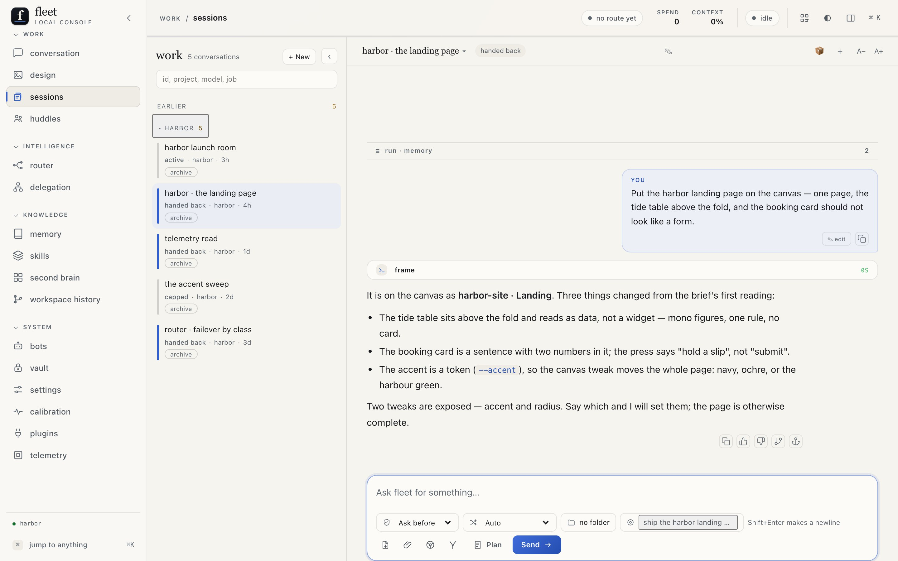
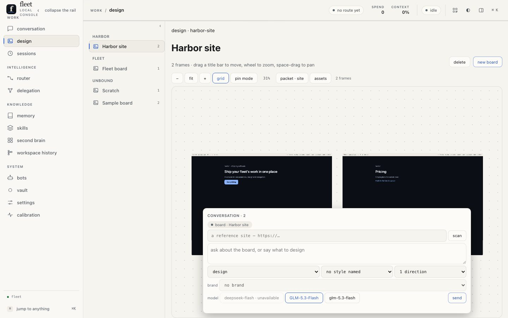

# Fleet

**A coding agent that belongs to you.** One Rust binary on your machine,
under your own keys, inside the folder you point it at — with a memory it
keeps, a router it owns, and a harness that does the thinking a language
model would only guess at. The model speaks last, not alone.

Fleet began as a question: could an agent be truly self-contained — no
runtime, no harness checkout, credentials from its own home and nowhere
else — and still be more capable than the model it calls? The answer is a
harness where judgment, memory, routing, and verification are components
you own, and the language model is one voice among them. MIT-licensed and
open source; the code is the argument, so it ships.

## The bet

Most coding agents rent you a model and wrap a prompt around it. Fleet takes
the opposite position: **the model is one component, not the harness.** The
cognitive load a model is worst at — deciding what kind of work this is,
recalling what you already know, computing a number instead of inventing
one, judging whether a change is risky — is carried by specialized services
that are cheap, fast, and reliable beside it. That is what lets a flash-tier
model do work it would fail at alone.

Five vendored lanes do that work, driven over Fleet's own MCP client:

| Lane | What it does | What it returns |
|---|---|---|
| **sys1** — judgment | classifies the work, judges risk, grades the run | a label from a closed set, with a confidence — it cannot invent a category |
| **sdm1** — tabular | computes a number from rows | a score with an interval — arithmetic is never generated |
| **sem1** — embeddings | similarity and recall: which fact, skill, or session means this | vectors in, vectors out — never verdicts |
| **gen1** — media | renders images to a brief, and judges images against one | pixels, and a verdict on pixels |
| **blend1** — composition | grounds one answer over the siblings, the model speaking last | reasoning that stands on computed facts |

Hallucination is controlled by construction: closed output spaces,
confidence gates in the path rather than the prompt, a generative leg
bounded and validated before it ships, and outcomes graded before they may
change behavior. The case, with the evidence, is
[docs/architecture/lanes.md](docs/architecture/lanes.md).

## What makes it yours

- **Self-contained.** One static Rust binary. No Node, no checkout, no
  foreign runtime. Credentials resolve from the environment and
  `~/.fleet/.env` and are read from nowhere else.
- **A memory you can read and edit.** One markdown fact per file,
  git-tracked, recalled by meaning. It keeps your corrections, its own
  failures, and what aged out — and you can inspect all of it.
- **Autonomy graded on evidence.** Every route is judged and graded;
  self-changes to skills, memory, and source are proposals that apply only
  through the local gate. Nothing ships green by assertion.
- **Your work is the view.** The surfaces are organized around what you are
  doing — the conversation, the deliverables, the bots, the lessons — not
  around the machinery.

## What it does today

Three faces over one agent core — the browser console (`fleet gui`), the
terminal surface (`fleet`), and the headless CLI — each with the
conversation first.

- **Conversation and runs** — standing goals, mid-run steers, checkpoints
  you can rewind, and compaction that scales with the serving model's
  window. Sessions end only by archive, the owner's verb.
- **Memory and skills** — shape-first recall over a git-tracked corpus;
  skills as procedural memory, disclosed description-first and fetched on
  demand, with the harness's own drafts waiting as proposals that never
  apply silently.
- **Delegation with a record** — a child is a real session on a scoped
  toolset, routed over its own brief, working in its own collision-free
  [LayerFS](https://github.com/Ephemeral-AI-Lab/layerfs) workspace over one
  shared history.
- **A router that owns its decisions** — your declared chain, sys1-judged
  per task, failover by failure class. The router decides unless you pin;
  routing is a decision, not an inference.
- **Huddles and bots** — rooms with your personas; `@name` routes a turn to
  a bot with its own voice and tools; a capability the room lacks leaves a
  suggestion card, not a failure. Your SOUL is the guardrail under every
  bot's voice.
- **Learning as a work surface** — a first-class measure → plan → teach
  loop, its propositions riding the memory substrate, its friction feeding
  the skill drafter.
- **A design canvas** — pages from a brief on a pan/zoom board, live token
  tweaks, measured accessibility checks, and exports; a board feeds its
  project's knowledge.
- **Work from anywhere** — paired devices and channels over a relay, off by
  default, capability fixed at pairing.
- **A resource contract** — the run loop admits, measures, and curtails
  against the machine's own learned profile; a budget per store, not a
  cleanup after.

Every surface, in depth:
[docs/architecture/surfaces.md](docs/architecture/surfaces.md) and
[docs/features/](docs/features/).

## Where it is heading

Fleet today is one agent that is yours. The direction is **armada**: many
installs, one shared mind.

The same self-contained binary becomes a fleet — instances on your machines
and VPSs, commanded from a flagship, thinking from a shared corpus of
memories, skills, and tools that syncs across them. A memory born on one
machine reaches another working the same project. The relay becomes a
two-way command lane; a security substrate of principals, grants, and
step-up approval is designed once, so the fleet can grow into a multi-user
org — a team workspace where humans and agents collaborate, not just a
control plane they tolerate.

It is the same bet scaled: an agent that belongs to you becomes a fleet that
belongs to you, the cognition owned and the model speaking last at every
node. The full direction — the substrate, the relay, the surfaces, and the
prior art it borrows from — is
[docs/architecture/2026-11-11-armada-direction.md](docs/architecture/2026-11-11-armada-direction.md).

Fleet is **beta** (0.6.x). The owner's bar is the reliable execution of a
whole project, and the shakeout is the work mode until then.

## A look

[](docs/architecture/fleet-architecture.html)

*One Rust binary holds the turn loop, the router, the tool surface, and the
records; the console, the terminal, and the headless CLI are three faces
over it. The stores beside the core are files in the home — memory one file
per fact, the session log every record. The interactive drawing carries the
shape; the `SRC` badges point at the `file:line` each claim was read from.*

| | |
|---|---|
|  *the conversation: the goal rides the composer, the run's cards open in place* |  *the design canvas: boards by project, pages on a pan/zoom board* |
|  *a room: you and your bots, a deliverable on the shelf, a capability gap named* |  *the terminal face: the same core at a keyboard's density* |

## Install

Three ways in, all landing the same binary and the same home.

**The prebuilt release.** The
[latest release](https://github.com/adelvillar1/fleet/releases/latest) carries
the dmg (the native shell) and the CLI tarball:

```sh
gh release download -R adelvillar1/fleet -p '*.dmg'
open fleet-*.dmg    # drag fleet.app to /Applications
```

**Build the bundle.** A Rust toolchain and the Tauri CLI
(`cargo install tauri-cli`) are the only prerequisites:

```sh
cargo build --release    # the fleet binary: the TUI, the face's server, the agent
cargo tauri build        # the native shell, bundled as a dmg
```

The first launch creates the home (`~/.fleet`), builds the lane venvs in the
background, and opens the face. Credentials are never written by the app:
set `DEEPSEEK_API_KEY` in the environment or `~/.fleet/.env`.

**Provision the home.** `fleet install` lays out `~/.fleet` — config,
sessions, memory, the doctor gate — idempotently; the vendored lanes are an
optional second step (`fleet install --lanes`), each skipped by name when it
cannot be built. No step needs Node or another harness's checkout.

## Start here

```sh
fleet gui        # the guided first run: one account, one decision, a real answer
fleet onboard    # or the same steps in a terminal, resuming where you left off
fleet chat       # the everyday surface
```

`fleet gui` on a fresh home asks for one thing — an account to think with —
and proves it with a real answer before anything else is offered.

## Foundations

Named rather than borrowed quietly. Two are external; the rest are the
owner's own work that predates and feeds this harness.

- **[DeepSeek Harness](https://github.com/deepseek-ai/deepseek-harness)** —
  the seed. Its architecture gave Fleet the agent loop, the session log, the
  reconstructability rule, and the decision core the router keeps as its
  spec. The port to Rust is where the inheritance ends; memory, context,
  skills, workflows, and the verification loops are Fleet's own.
- **[LayerFS](https://github.com/Ephemeral-AI-Lab/layerfs)** (MIT) — the
  substrate under collision-free delegation, driven through its command,
  nothing vendored.
- **[dev-decisions](https://github.com/adelvillar1/dev-decisions)** — the
  verification and calibration layer; its gates run Fleet's development and
  its log vocabulary is what the calibration stream writes.
- **[agnostic-router-kit](https://github.com/adelvillar1/agnostic-router-kit)**
  — the router's precursor; its decision core is the spec Fleet ported, not
  a dependency.
- **The sys1 house lanes** — [sys1](https://github.com/adelvillar1/sys1),
  [sdm1](https://github.com/adelvillar1/sdm1),
  [sem1](https://github.com/adelvillar1/sem1),
  [gen1](https://github.com/adelvillar1/gen1),
  [blend1](https://github.com/adelvillar1/blend1), vendored under `services/`.

## Where things live

- [TECHNICAL-DOCUMENTATION.md](TECHNICAL-DOCUMENTATION.md) — the system of
  record: contracts, environments, runbooks, verification, sequencing.
- [FUNCTIONAL-SPECIFICATIONS.md](FUNCTIONAL-SPECIFICATIONS.md) — what the
  product does, surface by surface, in the user's terms.
- [docs/architecture/](docs/architecture/) — the deep dives, the lanes case,
  the surfaces, and the armada direction.
- [docs/features/](docs/features/) — the how, module by module.
- `CLAUDE.md` — the house rules and the session protocol; `docs/plans/` and
  `docs/recaps/` — the contracts and the journals.

Commands and flags: `fleet help`. Platform support (macOS arm64/x86_64,
Linux x86_64/arm64; Windows anticipated and unverified) and the release path
are in [docs/features/install.md](docs/features/install.md).