# Fleet

**Fleet is a coding agent that runs on your machine, under your own keys,
inside the folder you point it at.** It remembers, delegates, schedules,
and routes each piece of work to the model your plans already pay for —
with five specialized services deciding, measuring, indexing and
rendering, and the language model speaking last. It began as a question:
could an agent be self-contained — one binary, no runtime, no harness
checkout, credentials from its own home and nothing else? The answer
that holds is a harness whose router it owns, whose memory it can read
and edit, whose self-changes are proposals that never apply silently,
and whose autonomy is graded on evidence. MIT-licensed; the repo is
private.

## The arc

**The idea.** An agent that belongs to its owner: one static Rust
binary, no Node runtime, no dependency on another harness's checkout,
credentials resolved from the process environment and
`<FLEET_HOME>/.env` and read from nowhere else. The agent loop, the
session log, and the rule that everything the model sees is
reconstructable from that log were inherited from the DeepSeek Harness's
architecture and reimplemented natively — a port, not a fork
(`docs/architecture/overview.md`).

**The experiment.** Absorb the whole ecosystem into that one binary:
the sys1 house's five lanes — judgment, tabular, embeddings, media, and
their grounded composition — driven over a hand-rolled MCP client; a
router the app owns, with the precursor's decision core as its spec
rather than its dependency; a calibration stream in dev-decisions'
vocabulary that grades what served; and a self-maintenance loop whose
changes to the harness's own skills, memory, and source are proposals
that apply only through the local gate. The methodology grew with it:
every non-trivial piece of work is a plan with acceptance criteria, and
the plan is the source of truth for whether it is done.

**The solution.** A language model is one component, not the harness.
Five specialized services do the work a model would only guess at, and
the language model speaks last:

| Lane | What it does | What it returns |
|---|---|---|
| **sys1** — judgment | classifies the work: which workload tier, which execution shape, is this diff risky, did the run land | a label from a closed set, with a confidence — it cannot invent a category |
| **sdm1** — tabular | computes a number from rows: classification or regression over a table | a score with an interval — arithmetic is never generated |
| **sem1** — embeddings | similarity and recall: which fact, which skill, which session means this | vectors in, vectors out — never verdicts |
| **gen1** — media | renders images to a brief, and judges images against one | pixels, and a verdict on pixels |
| **blend1** — composition | composes the three siblings under one grounded answer, with the language model speaking last | an answer whose reasoning stands on computed facts |

Hallucination is controlled by construction — closed
output spaces, confidence gates in the path rather than in the prompt, a
generative leg that is bounded and validated before it ships, and
outcomes that are graded before they may change behavior. That is what
lets flash-tier models do work they would fail at alone: the cognitive
load the model is worst at is carried by components that are cheap,
fast, and reliable beside it. The case, with the evidence, is
[docs/architecture/lanes.md](docs/architecture/lanes.md).

**Tested.** A local gate that runs whole — `cargo fmt --all --check`,
`cargo clippy --all-targets -- -D warnings`, `cargo build --release`,
`cargo test` — with a fixed eval corpus graded headless, plan-gate and
evidence-gate on the plans, arch-gate against the technical contract,
and the calibration stream recording every route, screening, and run
ending. Nothing ships green by assertion; each claim has a gate.

**Here.** Alpha, version 0.2.0, past the agent core: routing, memory
recall, delegation, scheduling, self-calibration, a browser face, a
terminal face, and the harness maintaining itself. What is next is
named, not implied — see Sequencing in
[TECHNICAL-DOCUMENTATION.md](TECHNICAL-DOCUMENTATION.md).

## What ships today

- **Three faces over one agent core** — the browser console
  (`fleet gui`), the terminal surface (`fleet`), and the headless CLI —
  each with the conversation first. What the surfaces are for, one by
  one, is [docs/architecture/surfaces.md](docs/architecture/surfaces.md).
- **A router that owns its decisions** — the owner's declared chain,
  sys1-judged per task, failover by failure class, and deepseek-flash as
  the tail every walk closes on. Work is judged into tiers — quick,
  standard code, **frontend** (interface surface routes to
  deepseek-flash first, GLM behind it across two more hosts), hard,
  prose, deep context — and nothing is hardcoded: the router decides
  unless you pin, and `--model` is a pin resolved by name.
- **Sessions that end only by archive** — the work list shows what is
  alive (`handed back`, `capped`, `working`), not what merely stopped;
  archiving is the owner's verb, and archived sessions gather in one
  collapsed group, restorable on demand.
- **A working folder that is a default** — set it once; every chat
  without its own choice works in it, and the face shows the folder the
  run will use.
- **Memory that reads and edits** — one markdown fact per file,
  recalled by meaning, with the corpus and its recall counts both
  inspectable.
- **Skills as procedural memory** — the library the model can reach,
  disclosed description-first, fetched on demand, with the harness's own
  drafts waiting as proposals that never apply silently.
- **Delegation with a record** — a child is a real session on a scoped
  tool set, routed by the router over its own brief, with the plan's
  dependency graph carried beside it.
- **Work from outside, by grant** — paired devices and channels, off by
  default, capability fixed at pairing.
- **Credentials that seal** — a vault that lists names and renders no
  value, with onboarding that migrates the plaintext `.env`.

The console, surface by surface — every destination a user lands on:

| | |
|---|---|
| 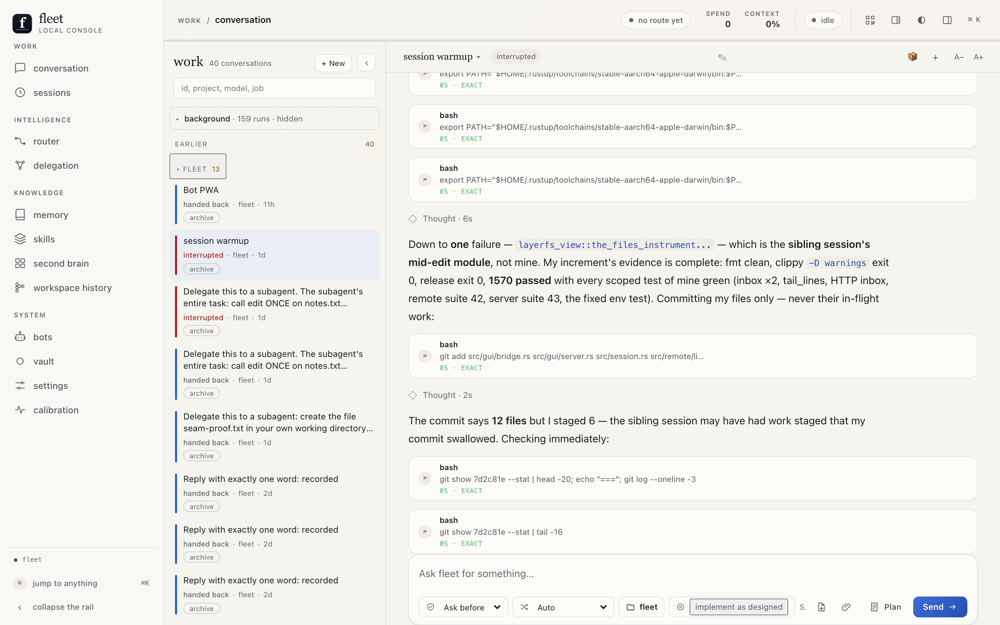 | 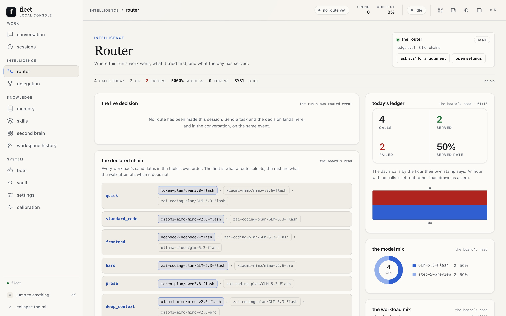 |
| 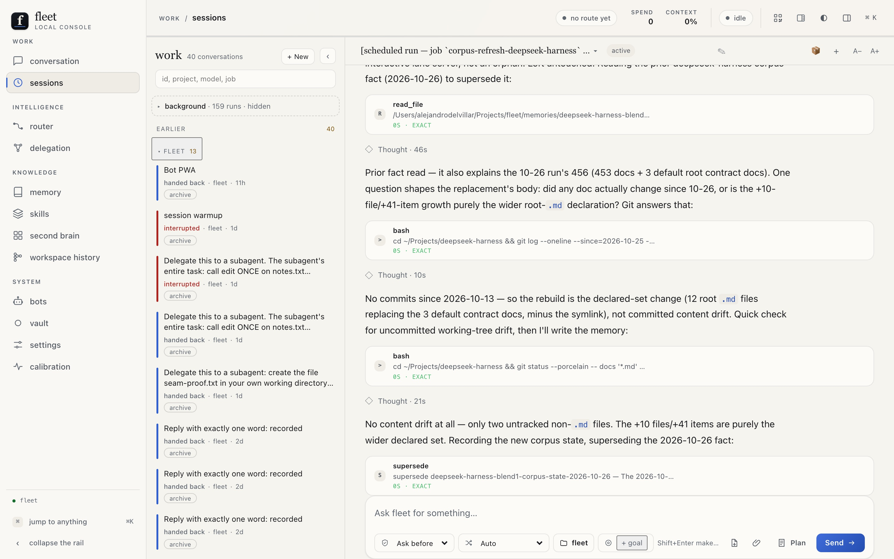 | 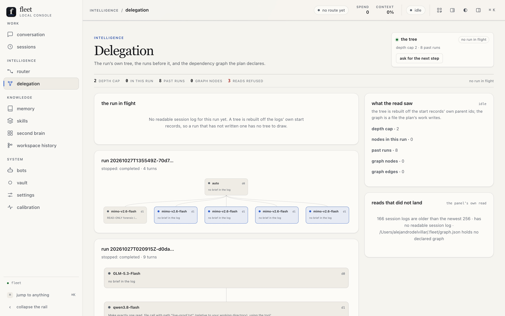 |
| 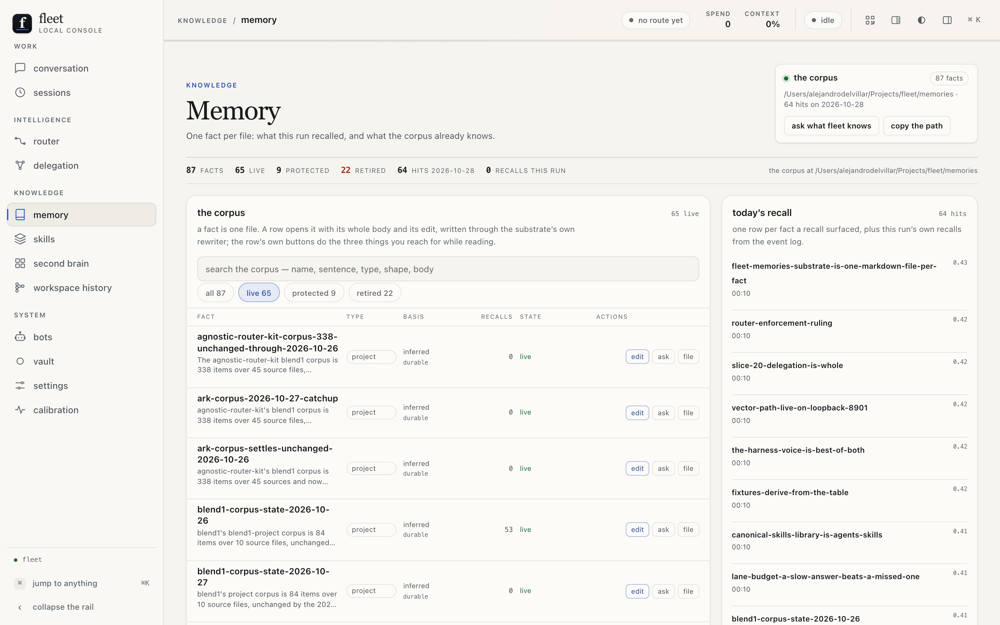 | 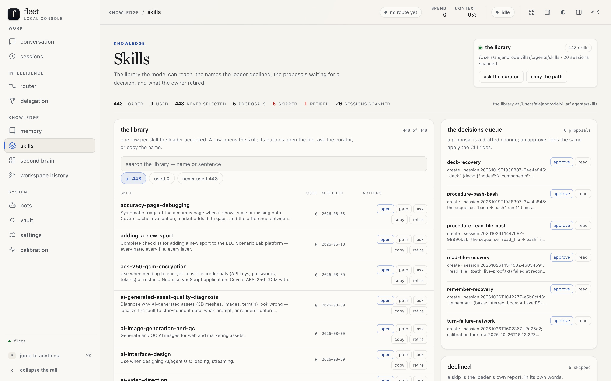 |
| 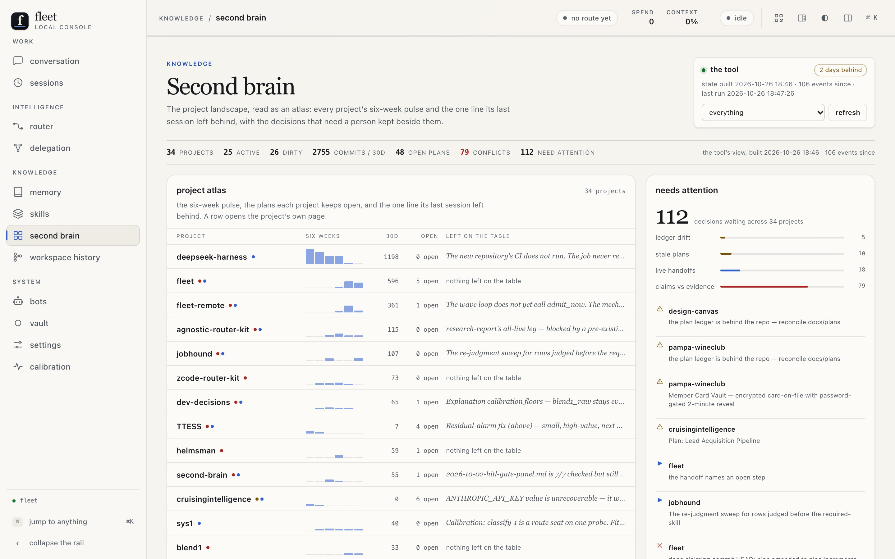 | 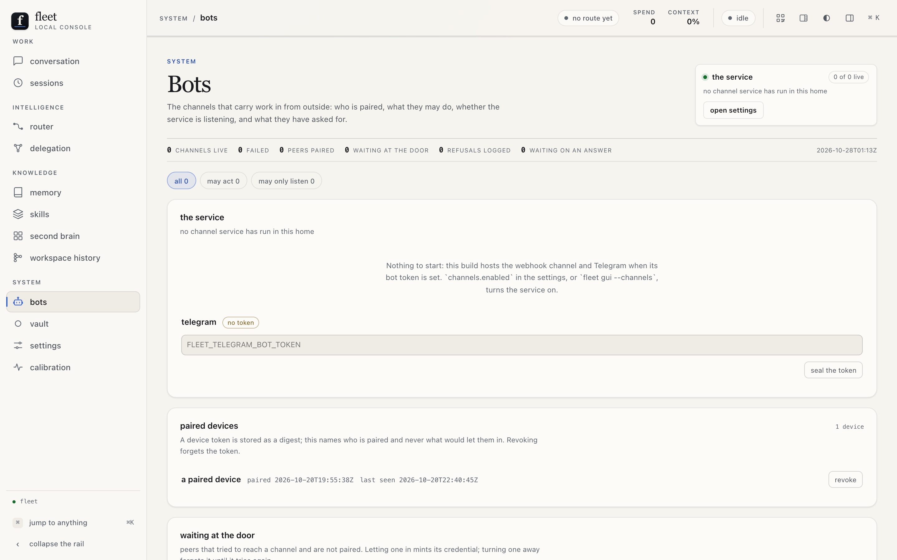 |
| 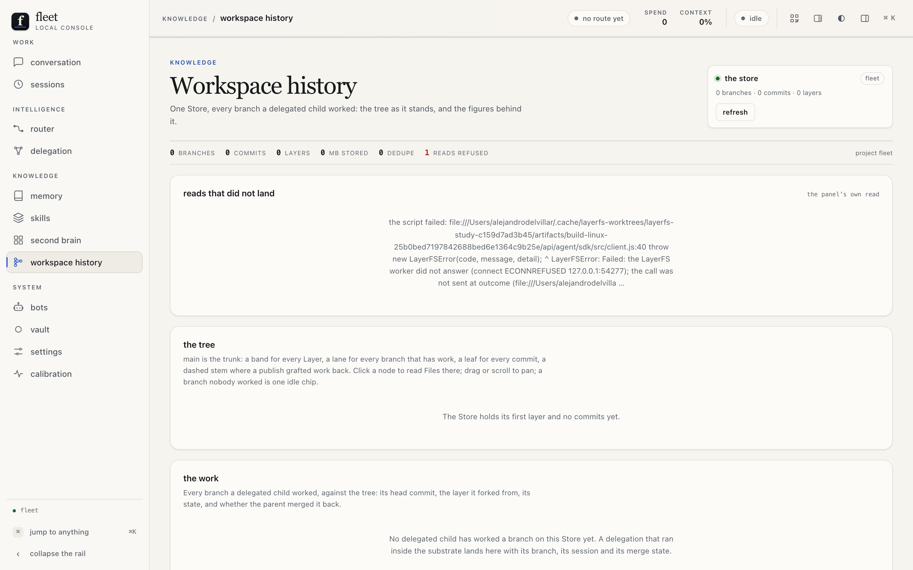 | 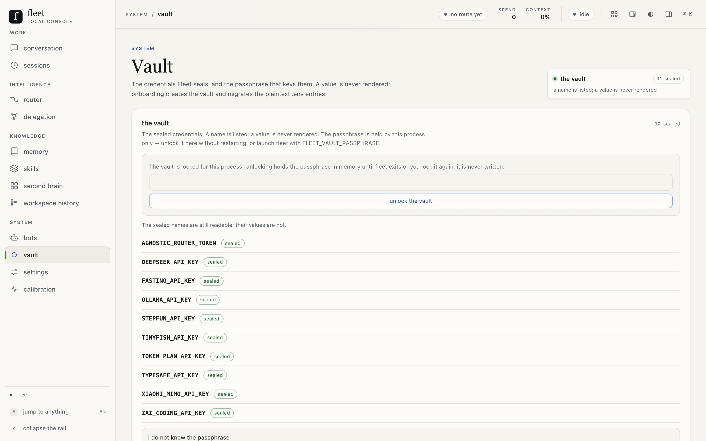 |
| 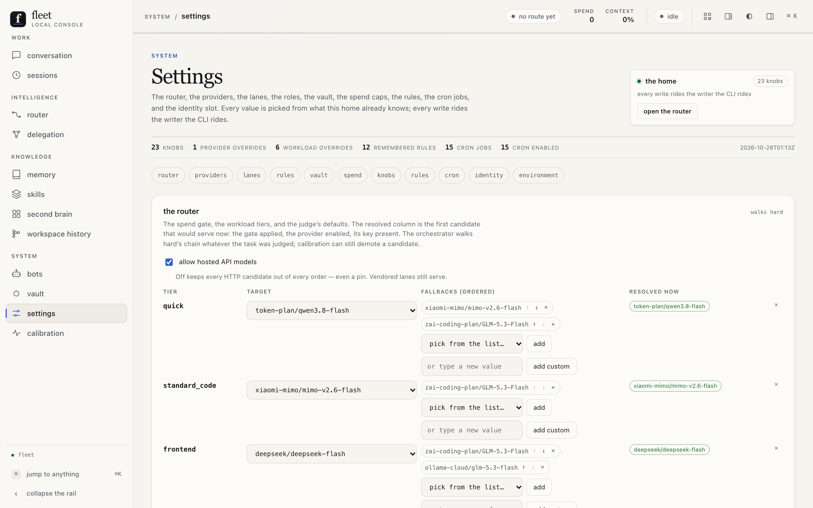 | 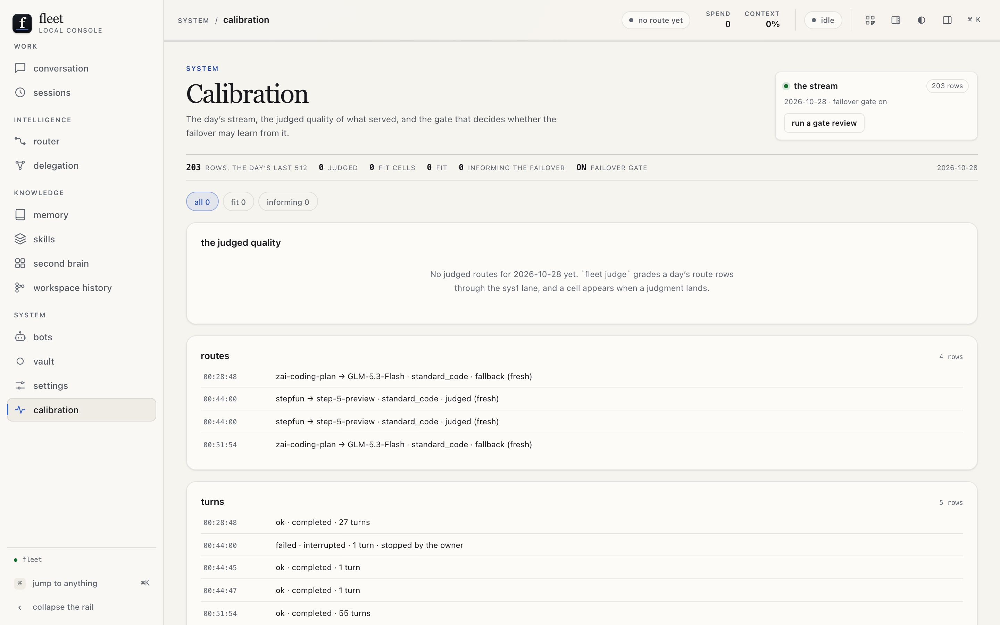 |

- **Collision-free delegation, on LayerFS** — each delegated child works
  in its own writable workspace over one shared committed history, so
  concurrent agents answer a named conflict instead of stepping on each
  other's code. Fleet drives
  [LayerFS](https://github.com/Ephemeral-AI-Lab/layerfs) (MIT) the way
  it drives the vendored lanes — an external tool reached through its
  `layerfs` command, with nothing of it vendored and no runtime entering
  the binary. `fleet install` provisions the substrate as a standard
  phase, and a folder's first delegation registers it with no manual
  step; the merged child's work is applied home through a named
  conflict path, never silently.
- **The workspace history instrument** — the LayerFS tree read as a
  surface: a band for every published layer, a lane for every branch at
  its actual fork, a leaf per commit, a dashed stem where a publish
  grafted work back, the substrate's live call feed, a file's
  text/blame/revisions/diff, and the Store's own accounting — all from
  one backend read that answers warm in under a quarter-second.

## What is next

Effort levels per workload (research done, plan not written); the
`composed` workload's reachability by judgment; the bot-first phone
shell; the cron corpus-refresh repair. Each is named with its reason in
the technical document's Sequencing section.

## Start here

```sh
cargo build --release                     # one binary at target/release/fleet
export DEEPSEEK_API_KEY=sk-...            # or KEY=VALUE in ~/.fleet/.env
target/release/fleet install              # the home, the config scaffold, the doctor gate
target/release/fleet doctor               # the gate on its own
target/release/fleet chat                 # the everyday surface
```

`fleet install` is idempotent; its exit code is the doctor's. The lanes
are vendored in this repository under `services/`, and their heavy
dependencies are an optional second step (`fleet install --lanes`), each
skipped by name when it cannot be built. No step needs Node or another
harness's checkout.

## Where things live

- [TECHNICAL-DOCUMENTATION.md](TECHNICAL-DOCUMENTATION.md) — the system
  of record for running the project: interface contracts, environments,
  runbooks, the verification and release process, the risk register,
  sequencing, and the module reference.
- [FUNCTIONAL-SPECIFICATIONS.md](FUNCTIONAL-SPECIFICATIONS.md) — what
  the product does, surface by surface, in the user's terms.
- [docs/architecture/surfaces.md](docs/architecture/surfaces.md) · the
  what and why of all twelve destinations.
  [docs/architecture/lanes.md](docs/architecture/lanes.md) — the five-lane
  case.
- `CLAUDE.md` — the house rules, the pointer index, and the session
  protocol (warmup → plan → build → recap → commit). `docs/plans/` and
  `docs/recaps/` — the contracts and the journals. `docs/features/` —
  the how, module by module.
- Commands, exit codes, and the CLI's flags: `fleet help` and
  [FUNCTIONAL-SPECIFICATIONS.md](FUNCTIONAL-SPECIFICATIONS.md). Platform
  support (macOS arm64/x86_64, Linux x86_64/arm64; Windows anticipated
  and unverified — KI-011) and the release path
  (`cargo build --release`, one binary at `target/release/fleet`) are in
  [docs/features/install.md](docs/features/install.md).
