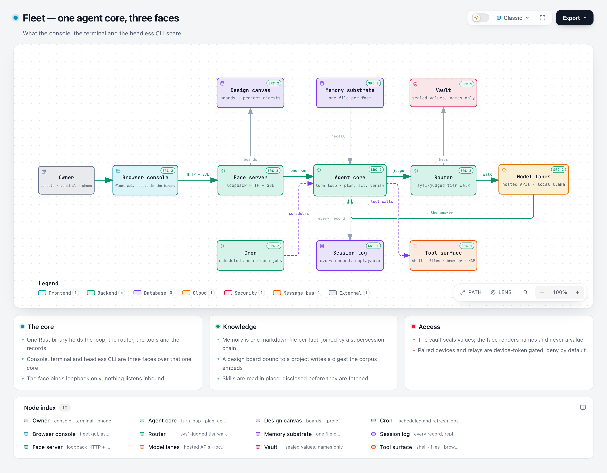
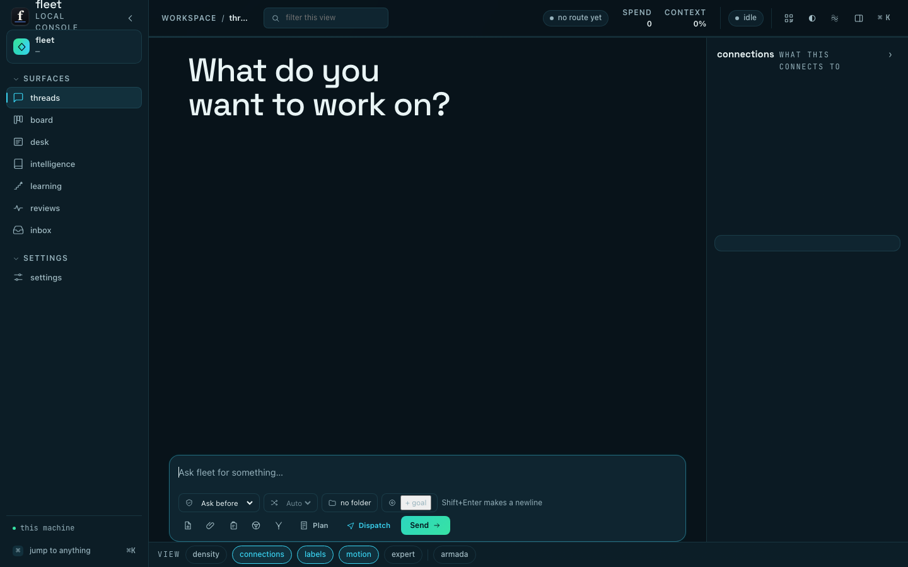
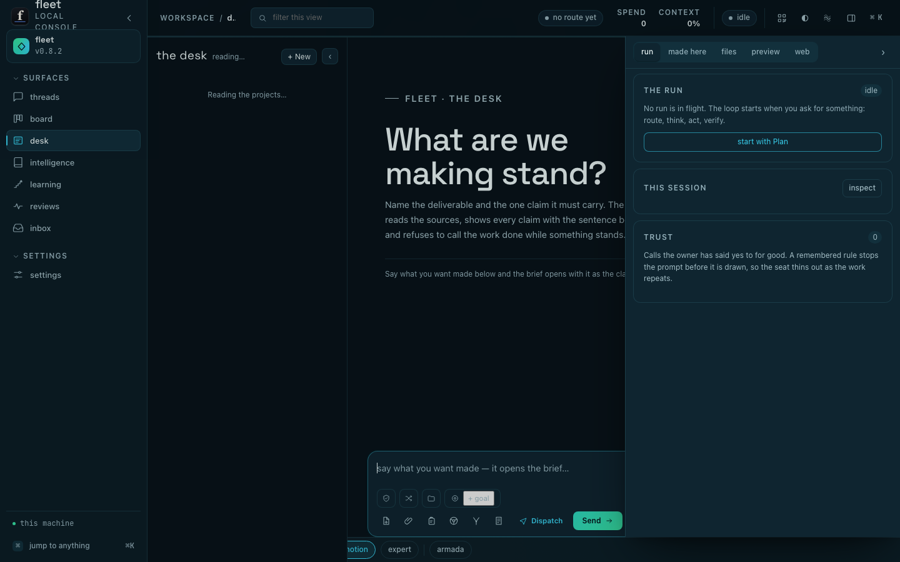
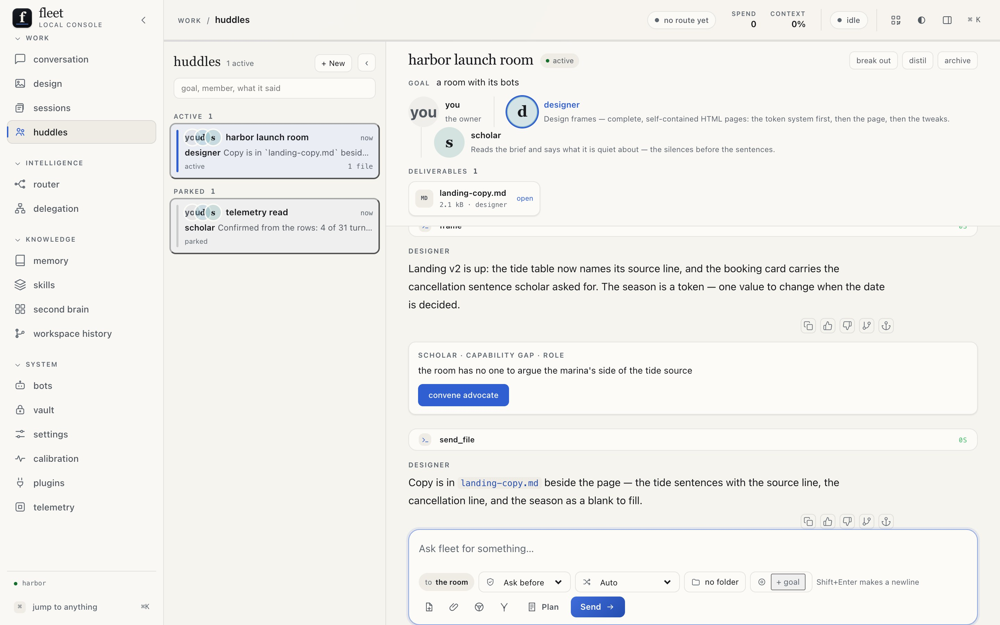
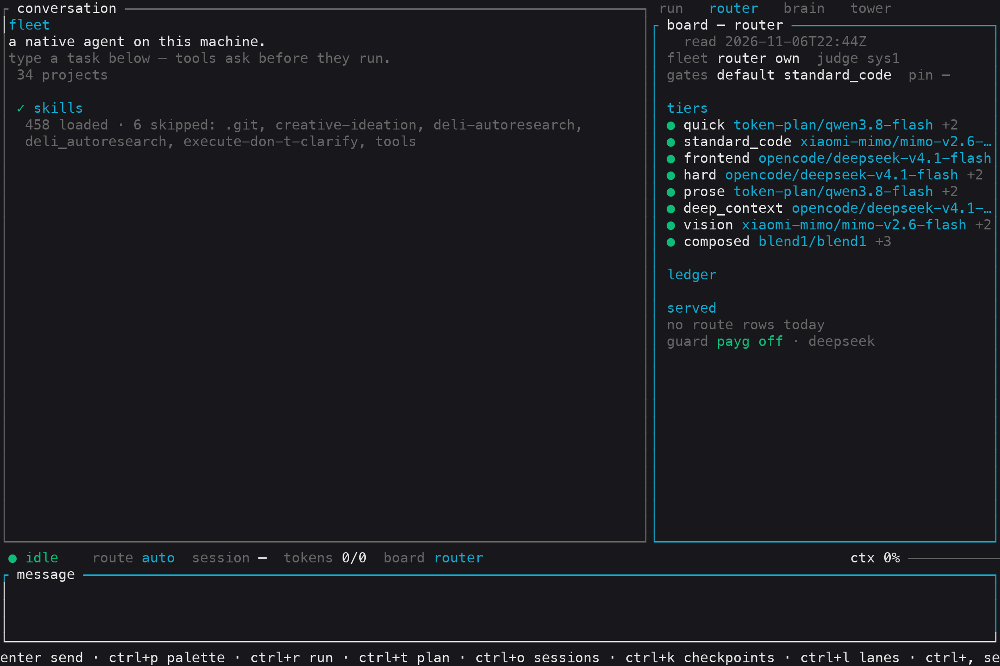

# Fleet

**A coding agent whose work you can verify.** Most agents ask you to trust a
black box: they guess a number, forget your context, change themselves
silently, and sound more confident the bigger the model gets. Fleet takes
the opposite position — **verifiable facts drive everything it does.** The
language model is one component, and it speaks last, standing on what the
harness has computed, recalled, and checked. You get capability you can
trust, a memory that compounds your knowledge, and a harness you govern.

It is one self-contained Rust binary on your machine, under your own keys,
in the folder you point it at. But that is table stakes. The thing that
matters is *how it knows what it knows* — and that nothing it does is beyond
your inspection. MIT-licensed and open source; the code is the argument, so
it ships.

## Why it is built this way

A language model is a convincing guesser. Ask it for a number and it will
produce one that sounds right; ask it whether a change is risky and it will
tell you a story. That is fine for drafting prose and dangerous for doing
work. So Fleet does not let the model guess at the things a guess gets
wrong:

- **Judgment** is a closed-set classification with a confidence, not an
  opinion.
- **Arithmetic** is computed from rows, never generated.
- **Recall** is vectors and ranked evidence, not the model's memory of you.
- **Risk** is graded against evidence before a destructive call runs.
- **Every decision** is recorded and later graded against its outcome.

The model still speaks — it composes, explains, and writes — but it speaks
*last*, on a foundation of facts the harness established. That is what lets
a cheap, fast model do work it would fail at alone: the cognitive load it is
worst at is carried by components that are reliable beside it.

## What is in it for you

### Work you can trust

Five specialized lanes do the grounding, driven over Fleet's own MCP client:

| Lane | What it does | What it returns |
|---|---|---|
| **sys1** — judgment | classifies the work, judges risk, grades the run | a label from a closed set, with a confidence — it cannot invent a category |
| **sdm1** — tabular | computes a number from rows | a score with an interval — arithmetic is never generated |
| **sem1** — embeddings | similarity and recall: which fact, skill, or session means this | vectors in, vectors out — never verdicts |
| **gen1** — media | renders images to a brief, and judges images against one | pixels, and a verdict on pixels |
| **blend1** — composition | grounds one answer over the siblings, the model speaking last | reasoning that stands on computed facts |

Hallucination is controlled by construction: closed output spaces,
confidence gates in the path rather than the prompt, a generative leg
bounded and validated before it ships. The case, with the evidence, is
[docs/architecture/lanes.md](docs/architecture/lanes.md).

### A memory that compounds your knowledge

Memory is not a black box you hope remembers you. It is a corpus of
markdown facts, one per file, git-tracked, that you can read and edit. Every
fact names *how it is known* — stated by you, inferred by the harness, or
validated against evidence — and a nightly dream pass checks the inferences
against their sources. Your corrections are a protected tier that is never
evicted; the harness's own failures are kept as anti-vectors so it does not
repeat them; recall is shape-first, so the problem's structure finds the
relevant knowledge and the words corroborate within it. What ages out is
superseded and archived, not lost. The longer you work, the more the harness
knows — and you can audit every bit of it.
([docs/features/memory.md](docs/features/memory.md))

### Capability you govern

The harness grows its own skills, tools, workflows, and loops — but never
silently, and never beyond your reach:

- **Skills** are procedural memory, disclosed description-first and fetched
  on demand. The harness drafts new ones from session evidence, but they
  wait as *proposals* that apply only through the gate.
- **Tools** are a bounded set — the built-ins plus the lanes over MCP — every
  call validated, the destructive class held at an approval seat you answer.
  The harness cannot reach what it is not granted.
- **Workflows** are composed and named: the skill chains
  (warmup → plan → build → recap), delegation with a dependency graph, rooms
  with your bots. Work is structured, not improvised.
- **Loops** are how the harness maintains itself on evidence: calibration
  grades every routing decision against its outcome; self-improvement
  proposes changes that are *measured before they are kept*, reversible, and
  leave a lesson behind; the learning loop teaches from the substrate; the
  health loop watches the machine and — when a service it watches is down —
  the face asks *do you want to repair it?* and the press runs the repair,
  never a narrated command. Every self-change is gated.

The thread through all of it: grounded in facts, bounded by closed sets and
gates, governed by proposals and approval, auditable through provenance and
logs. ([docs/features/](docs/features/))

### One productive front end

Fleet is not a chat window you visit — it is meant to be the place your work
lives. The 0.8 shell is one workspace, not twenty panels: seven lenses
(threads, board, desk, intelligence, learning, reviews, inbox) project one
work-object spine — a task links to its conversation, its deliverable, the
bot that did it, and the lesson it taught — one shared focus that a pivot
re-projects into the lens it names, and the inspector rides beside it as a
drawer: the run, the receipts of what the conversation made, the files, the
preview. The landing is one question — *"What do you want to work on?"* —
over the composer, with the onboard door when the home needs setup; the
graph, the counts and the archive live on their own surfaces, one pivot
away. Runs are concurrent: each admitted run drives its own session, a run
in another conversation changes a row's words, not this composer's. Three
faces over one agent core — the browser console (`fleet gui`), the terminal
(`fleet`), and the headless CLI — plus a native desktop shell and a paired
phone, paired from the app itself: the face mints the code, the phone joins
through the relay, no terminal command.
([docs/architecture/surfaces.md](docs/architecture/surfaces.md),
[docs/features/workspace.md](docs/features/workspace.md))

### A responsible citizen on your machine

Most agents treat the host as infinite — they fill the disk, spawn processes
without count, and tidy up afterwards if they remember. Fleet takes the
opposite posture: it is a *responsible* citizen, not merely a good one. A
good citizen cleans up after itself; a responsible one has a budget it stays
under and refuses work *before* it starts rather than rescuing it after.

Every unit of work moves through four beats: **measure** the machine (free
space, the process tree, a reserve derived from the environment's own
history), **admit or refuse** against the headroom — deterministic, so "six
gigabytes of room, eight of work" needs no judgment — **work**, then
**settle and curtail**: re-measure, and a delta past the budget is an overage
while a delta past the reserve is a *breach* that pauses the run and puts the
numbers in front of you. The numbers derive from the machine's learned
profile, not constants, and the harness is aware at all times of what it
holds — disk, memory, its own process tree. A call that keeps the environment
from crashing is worth its cost; a runaway is curtailed, not rescued.
([docs/features/resource-contract.md](docs/features/resource-contract.md))

## How it stays trustworthy

The method is the scientific one, applied to the harness itself. Every
non-trivial change is a **plan with acceptance criteria** — the hypothesis.
The build is the experiment. The **gate** is the measurement:
`cargo fmt`, `clippy`, `build`, `test`, the fixed eval corpus, and the plan,
evidence, and architecture gates over the plans, exit codes read directly.
The **calibration stream** grades the decisions against their outcomes, and
your agree-or-disagree rides the same append-only row as ground truth. The
recap is the conclusion. Nothing ships green by assertion; each claim has a
gate, and the gates grade themselves.

That is the whole bet: an agent that gets more capable without getting less
reliable, because every increase in capability is measured against evidence
before it is kept.

## Armada: one shared mind (0.7.0)

Fleet is one agent whose work you can verify — and, with **0.7.0**, the first
lane of **armada** is built: many installs, one shared mind. The same
self-contained binary becomes a fleet — instances on your machines and VPSs,
commanded from a flagship, thinking from a shared corpus of memories, skills,
and tools that syncs across them. A memory born on one machine reaches another
working the same project.

It was built bottom-up, one responsible layer at a time, each gated and cut on
its own (v0.6.31 → v0.7.0):

- **Identity and a durable journal** — every install has a stable id; every
  decision rides an append-only event stream you can replay.
- **A security substrate** — principals, grants, and step-up approval, designed
  once. Authority rides *signed in the frame* and is verified before an instance
  obeys; the relay stays a dumb broker that cannot fabricate.
- **A shared corpus** — git-synced memory with measured merge rules, so two
  installs converge without losing facts.
- **A responsible communication edge** — a durable outbox that loses no reply,
  an identity graph across channels, dispatch gated by the principal's grants.
- **A work-object graph** — a task links to its conversation, its deliverable,
  the bot that did it, and the lesson it taught; the surfaces become views over
  one workspace, not a drawer of silos.
- **A control plane** — a flagship roster with liveness *earned* by heartbeats,
  control verbs through each instance's own guard, and dispatch autonomy earned
  by measured reliability, never by registration.
- **Deployment and the surfaces** — fleet deploying fleet (a local spawn or a
  VPS over SSH), a fresh install inheriting the mind and trusted only after it
  passes doctor and settles runs; a TUI armada board, a face armada section, and
  the native shell wrapping the same face — one implementation, four surfaces.

It is the same bet scaled: capability you can trust, memory that compounds, a
harness you govern — at every node. The architecture borrows openly from
muxin, omni, and orbit (credited under [Foundations](#foundations)); the shared
corpus, the substrate, and the org are Fleet's own.

## Where it is heading

The direction now is the **org** (lane 2): the substrate generalizes from one
owner to a team — more principals, roles as grant templates, per-user factors,
team and org scopes — a team workspace where humans and agents collaborate, on
the same fact-driven foundation. Not a rewrite: the substrate was built for it
out of the gate, so the org inherits its admin layer already working. The full
direction is
[docs/architecture/2026-11-11-armada-direction.md](docs/architecture/2026-11-11-armada-direction.md).

Fleet is **beta** (0.8.x). The owner's bar is the reliable execution of a
whole project, and the shakeout is the work mode until then.

## A look

[](docs/architecture/fleet-architecture.html)

*One Rust binary holds the turn loop, the router, the tool surface, and the
records; the console, the terminal, and the headless CLI are three faces
over it. The stores beside the core are files in the home — memory one file
per fact, the session log every record. The interactive drawing carries the
shape; the `SRC` badges point at the `file:line` each claim was read from.*

| | |
|---|---|
|  *the landing: one question over the composer — the onboard door when the home needs setup, the seven lenses in the rail* |  *the desk, the inspector as a drawer over the work: the run, the receipts of what the conversation made, the files, the preview* |
|  *a room: you and your bots, a deliverable on the shelf, a capability gap named* |  *the terminal face: the same core at a keyboard's density* |

## Install

Three ways in, all landing the same binary and the same home.

**The prebuilt release.** The
[latest release](https://github.com/adelvillar1/fleet/releases/latest) carries
the dmg (the native shell) and the CLI tarball:

```sh
gh release download -R adelvillar1/fleet -p '*.dmg'
open fleet-*.dmg    # drag fleet.app to /Applications
```

**Build the bundle.** A Rust toolchain and the Tauri CLI
(`cargo install tauri-cli`) are the only prerequisites:

```sh
cargo build --release    # the fleet binary: the TUI, the face's server, the agent
cargo tauri build        # the native shell, bundled as a dmg
```

The first launch creates the home (`~/.fleet`), builds the lane venvs in the
background, and opens the face. Credentials are never written by the app:
set `DEEPSEEK_API_KEY` in the environment or `~/.fleet/.env`.

**Provision the home.** `fleet install` lays out `~/.fleet` — config,
sessions, memory, the doctor gate — idempotently; the vendored lanes are an
optional second step (`fleet install --lanes`), each skipped by name when it
cannot be built. No step needs Node or another harness's checkout.

## Start here

```sh
fleet gui        # the guided first run: one account, one decision, a real answer
fleet onboard    # or the same steps in a terminal, resuming where you left off
fleet chat       # the everyday surface
```

`fleet gui` on a fresh home asks for one thing — an account to think with —
and proves it with a real answer before anything else is offered.

## Foundations

Named rather than borrowed quietly. Two are external; the rest are the
owner's own work that predates and feeds this harness.

- **[DeepSeek Harness](https://github.com/deepseek-ai/deepseek-harness)** —
  the seed. Its architecture gave Fleet the agent loop, the session log, the
  reconstructability rule, and the decision core the router keeps as its
  spec. The port to Rust is where the inheritance ends; memory, context,
  skills, workflows, and the verification loops are Fleet's own.
- **[LayerFS](https://github.com/Ephemeral-AI-Lab/layerfs)** (MIT) — the
  substrate under collision-free delegation, driven through its command,
  nothing vendored.
- **[dev-decisions](https://github.com/adelvillar1/dev-decisions)** — the
  verification and calibration layer; its gates run Fleet's development and
  its log vocabulary is what the calibration stream writes.
- **[agnostic-router-kit](https://github.com/adelvillar1/agnostic-router-kit)**
  — the router's precursor; its decision core is the spec Fleet ported, not
  a dependency.
- **The sys1 house lanes** — [sys1](https://github.com/adelvillar1/sys1),
  [sdm1](https://github.com/adelvillar1/sdm1),
  [sem1](https://github.com/adelvillar1/sem1),
  [gen1](https://github.com/adelvillar1/gen1),
  [blend1](https://github.com/adelvillar1/blend1), vendored under `services/`.

### Inspiration for armada

The armada layers borrow *architecture* openly, not code — named here rather
than quietly. Each is a different open-source project whose pattern Fleet
adapted to its own Rust, fact-driven foundation:

- **[muxin](https://github.com/LumaryLabsLLC/muxin)** (Lumary Labs, Apache-2.0)
  — "all your machines, one console." The on-machine instance-agent +
  persistence, agent-first/MCP-first surfaces, mutual cert pinning, and auto-join
  provisioning. muxin manages machines and sessions; armada shares a *mind* —
  Fleet keeps its own Tauri surfaces and dial-out relay, and adds the shared
  corpus, the security substrate, and the org that muxin does not address.
- **[omni](https://github.com/automagik-si/omni)** (automagik-si) — a universal
  event-driven omnichannel communication layer for agents. The architecture:
  the journal as the source of truth, durable consumers, channel plugins, an
  identity graph, and gated agent dispatch. Fleet borrows the pattern, not the
  stack (Bun/NATS JetStream/PostgreSQL) — it rides Fleet's own journal and relay,
  in Rust, self-contained.
- **[orbit](https://github.com/coollabsio/orbit)** (coollabsio, Apache-2.0) — a
  self-hosted team workspace (tasks, docs, chat, mail), the open-source
  Slack/Linear/Notion alternative. The tool set a team actually needs, and an
  admin layer — roles, audit, rate limits, tokens, export — that maps almost
  one-to-one onto armada's substrate, independently confirming its shape. The
  org (lane 2) grows into this.

## Where things live

- [TECHNICAL-DOCUMENTATION.md](TECHNICAL-DOCUMENTATION.md) — the system of
  record: contracts, environments, runbooks, verification, sequencing.
- [FUNCTIONAL-SPECIFICATIONS.md](FUNCTIONAL-SPECIFICATIONS.md) — what the
  product does, surface by surface, in the user's terms.
- [docs/architecture/](docs/architecture/) — the deep dives, the lanes case,
  the surfaces, and the armada direction.
- [docs/features/](docs/features/) — the how, module by module.
- `CLAUDE.md` — the house rules and the session protocol; `docs/plans/` and
  `docs/recaps/` — the contracts and the journals.

Commands and flags: `fleet help`. Platform support (macOS arm64/x86_64,
Linux x86_64/arm64; Windows anticipated and unverified) and the release path
are in [docs/features/install.md](docs/features/install.md).