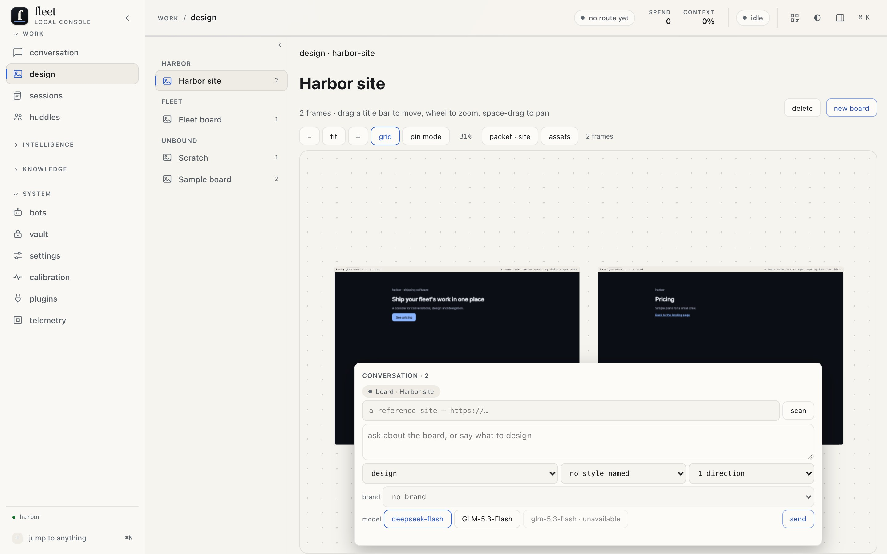

# The design canvas

Fleet's own board of designed pages. A **frame** is one complete,
self-contained HTML page — the artifact a design run produces — and the
canvas is where frames land, get tweaked, pinned, reviewed and handed
off. It is the **native descendant of the owner's design-canvas
project**: the canvas, its frame model and its contract came over
(the frame is opaque HTML, the array order is z-order, a tweak is a
`:root` variable), and what stayed behind is that app's SaaS shell —
billing, accounts, publishing, collaboration, its Prisma/Postgres
store — because a board is one document in the home and the face
already owns the writes. The reasoning, the leg-by-leg mapping and what
was deliberately not ported (vector editing, undo for geometry) live in
[docs/plans/2026-10-31-design-canvas-native.md](../plans/2026-10-31-design-canvas-native.md).

## In pictures



*The board at 1440×900 from a scratch home (the owner's canvas is never
the fixture): the boards rail grouped by the project each board belongs
to, the canvas with its pages and the zoom controls, and the composer
floating at the canvas's center. The head carries the save chip and the
board's settings; a page selected swaps the composer's focus to
`page · <name>`, a review card puts the deterministic scan above the
model's eight scores and **the ask**, the export card lists the
downloads by kind, and the same board serves as a site at
`/site/<slug>/` — the frames themselves, network-dead.*

## The surface

The canvas sits directly under the conversation in the rail's work
group — it is work the owner opens the way they open a chat, not a
listing to browse after one.

`#/design` is a split stage like settings and calibration: the **boards
rail** on the left — the same `sectionRail` every split page renders,
now **grouped by the project each board belongs to** (one header per
bound family, then an `unbound` section; the rows are the owner's board
names, and a clipped board name is a board you cannot tell apart) — and
the canvas filling the body: a head (the board's name — **double-click
it to rename in place** — the frame count, the **save chip**, **delete**
and **new board**), an instrument strip (zoom out / fit / zoom in / grid
/ pin mode / the zoom readout), the **viewport**, and the
**conversation as one floating stack at the bottom-center of the
canvas** — the log (collapsed to the composer by default, the toggle
counting the turns), the approval seat, and the composer itself, in the
conversation stage's own idiom (the owner's 2026-11-01 ruling: the
composer lives in the center frame like sessions and conversations).
The viewport is a clipping box holding a world under one CSS transform
— `translate(x,y) scale(z)` — and the world holds the frame cards.
Fleet's tokens, cards and buttons are the chrome; the frame inside its
sandboxed iframe is the artifact, which is the same boundary the
preview pane already draws for documents and web pages.

Gestures, all vanilla JS on the face's own pointer idioms:

- **Wheel** zooms toward the cursor (0.05–2.5) — from the canvas, not
  from inside the floating composer, which owns its own events.
- **Drag the empty board, or space/middle-drag anywhere**, pans; a
  press on the background **clears the focus** back to the board.
- **Fit** frames the board's bounds into the viewport.
- **Drag a title bar** moves its frame: the delta divides by zoom and
  rounds to whole world units, then the position is written.
- **Click a title bar** selects; arrows nudge 16 (1 with Shift).
- **Double-click a title bar's name** renames the page in place — the
  write rides `frame-update {name}`, the same plumbing the model's
  own renames use.
- **Pin mode**, then click a frame body, and the pin lands at that
  normalized point.
- The zoom and pan are remembered per board in `localStorage`.

Every gesture that changes the document **writes through the design
writer**. The board file is the truth; the view is a projection of it —
and the head's **save chip** says so: `saving…` while a write is in
flight, `saved` on its ack, `save failed: <reason>` when the writer
refuses. One chip, one wrapped function; no gesture leaves the page
guessing.

## Boards and pages

Boards and pages have full CRUD through the writer. The head renames
the board (double-click the title) and deletes it — a confirm names
what it takes (the frame count, the conversation, the files), and the
store directory, the board's digest and its fact go with it. Pages
rename in place (double-click the title bar's name), duplicate, and
delete; they carry a **set picker** on the bar — the membership the
model's `set` argument writes, assignable by hand (an empty pick
clears it, and the badge follows the re-read). The bar also carries
the **viewport presets** (the source's own placement): one button per
size, the current one marked, the press resizing the page through the
writer.

## Boards are project knowledge

A board carries its **project binding** — the folder it belongs to,
set from the head's picker (the binding is a field; the store stays
home-flat). The binding feeds three channels (the owner's 2026-11-01
ruling): every save regenerates the board's **digest** at
`canvas/digests/<project-key>/<slug>.md` — a deterministic markdown
account of pages, tokens, reviews and brand — the corpus-refresh jobs
embed those digests beside the project's docs (the KI-277 reconcile
carries the wording to existing jobs), and a run born in that
workspace assembles a bounded **design section** from them in its
context. Board create, rename, bind and delete each move one
`design-board-<slug>` fact through the substrate's own writer, so
recall ranks the board for a design instruction about its project.
Unbound boards stay visible in the rail's `unbound` section.

## The board's conversation

The floating stack holds the board's chat, and it is part of the
document: the turns live in `project.json`, so a reload, the CLI and a
cron job read the same conversation. Each turn carries the frames it
landed as **chips**; a chip's press selects its page on the board and
fits the view. The composer's **verbs** follow the selection — *design*
(one or more new frames), *refine* (a new version of the selected
frame), *another direction* (a fresh frame beside it), *apply the
review's fixes* (when the frame has a review), and *ask* (a question
about the board, which writes nothing).

**The focus is first-class** (the owner's rule): with **no page
selected the request is global** — the focus chip reads `board ·
<name>`, the placeholder and verbs are the board's; **a page selected
makes the request about that page** — the chip reads `page · <name>`,
the mode defaults to refine, and the wire carries that `frame_id`.
Clicking the canvas background clears the selection and the focus
returns to the board; a send with no page composes a board-global
task, one with a page carries that `frame_id`.

The composer carries a **directions** count: a brief can ask for up to
four clearly different pages, one `frame` per direction, on one run.

## The document

`<fleet-home>/canvas/<slug>/project.json`:

```json
{
  "version": 1, "name": "Sample board",
  "created": "…", "updated": "…",
  "frames": [
    { "id": "f-…", "name": "hero", "description": "",
      "html": "<!doctype html>…", "x": 0, "y": 0, "w": 1280, "h": 900,
      "tweak_spec": [ { "key": "accent", "label": "accent", "kind": "color",
                        "default": "#3b6cf6", "css_var": "accent" } ],
      "tweak_values": { "accent": "#3b6cf6" },
      "model": "glm",
      "versions": [ { "id": "v-…", "name": "hero", "html": "…",
                      "tweak_values": {}, "source": "generate", "created": "…" } ],
      "pins": [ { "id": "p-…", "x": 0.5, "y": 0.25, "text": "…",
                  "source": "owner", "resolved_frame_id": null, "replies": [] } ],
      "review": { "kind": "vision", "scores": {}, "summary": "…",
                  "strengths": [], "fixes": [], "history": [] },
      "created": "…", "updated": "…" }
  ]
}
```

**Array order is z-order** — frames render in array order, as the source
did. Pins are normalized 0–1 of the frame's own size, so a viewport
switch never moves them. Caps, enforced by the writer: **512 KiB** of HTML
per frame, **20 versions** per frame, **10 reviews** kept in a frame's
history. A fresh home adopts the bundled sample board (the two
proven-valid fixture frames from the source project).

The project also carries `brand` (the design system it designs under) and
the board keeps its files beside the document:

```
<fleet-home>/canvas/<slug>/project.json     the board
<fleet-home>/canvas/<slug>/assets/          the board's files + manifest.json
<fleet-home>/canvas/brands/<name>.json      the home's design systems
```

## The tools

Two model-facing tools carry the canvas, both available to any run:

- **`frame`** — `{project, name, html, frame_id?, tweak_spec?}`. The page
  is validated before it lands (a complete document, under the cap) and
  the frame id comes back. With `frame_id` the call **refines** that
  frame instead: the previous page is snapshotted as a version. This is
  how a design run fills the board — the canvas is the destination of
  fleet's design artifacts, not a separate app.
- **`review_frame`** — `{project, frame_id, scores?, summary?, strengths?,
  fixes?}`. Stores a structured review on the frame; the canvas shows it
  beside its own deterministic checks.

The **`designer` role** (`roles/designer.md`) is the persona that uses
them: a frame is one complete page opened by its conclusion, the token
system comes first, and refining means keeping the frame's identity.

## Assets

A page stays one self-contained document, so an image is **inlined**, never
linked. The board keeps the files it uses under `canvas/<slug>/assets/`
with a `manifest.json` (name, file, sniffed MIME, bytes, created), and a
page refers to one by name: `{{img:mark}}`.

- **The `frame` tool's `assets`** takes `[{name, path}]`. A `path` hands a
  file in: it is read (only inside the fleet home or the run's working
  directory — a call cannot read the machine behind the owner's back),
  MIME-sniffed from its magic bytes, capped at **256 KiB**, and stored on
  the board first. An entry with only a `name` resolves one the board
  already keeps. Either way the placeholder becomes the asset's `data:`
  URI, and a placeholder naming a file the board does not keep is refused
  by name rather than rendered literally.
- **`PUT`-style upload** — the writer's `asset-put` op takes `{project,
  name, data (base64), mime?}`; a declared MIME must agree with the bytes.
  The assets panel in the pane lists the board's files (thumbnails through
  `/api/design/asset/<slug>/<name>`), copies a placeholder in one press,
  drops a file, and imports an SVG as a page.
- **The SVG import is sanitized** (`canvas::svg_sanitize`): `<script>`,
  `<foreignObject>`, `<iframe>`, `<object>` and `<embed>` go, `on…=`
  handlers go, and an `href`/`src` that reaches outside the file
  (`http:`, `https:`, `//`, `javascript:`, `data:text/html`) goes — the
  picture still renders. `asset-frame` then wraps the cleaned mark in a
  centred document: an imported logo is a frame like any other.

The caps are refusals by name: 256 KiB per asset, 64 assets per board,
and only the image types the canvas can inline (png, jpeg, gif, webp, svg).

## Brands

A brand is a design system the home keeps: `<home>/canvas/brands/<name>.json`
holds `{name, tokens, doctrine}` — `:root` custom property names and
values, plus the sentence or three a designer reads as standing
instruction. A board **chooses** one (`brand-use`), and from then on:

- the tokens seed the **default colours of every frame landed there** —
  a `color` tweak whose key names a brand token starts at the brand's
  value (a slider keeps its own number: a token is a declaration);
- the tokens and the doctrine **ride the composed task**, so a run knows
  the palette before it writes a page.

Caps: 32 tokens, a 120-character token value with no `;` or `}`, 2,000
characters of doctrine, 50 brands per home. A choice naming a brand the
home no longer keeps reads as *missing* rather than silently clearing.

## The style library

The composer's style picker carries the source project's **62 directions**
— the curated ten (editorial, technical, paper, industrial) and the mined
fifty-two (style families and recognizable brand languages) — as data:
`src/gui/assets/design-presets.json`, grouped by the library's own
category. Each entry is split where the source splits it: the `spec` is
the positive prompt, and its **`avoid` list is the negative one**, riding
the task as `Avoid: …` after the style line. Nothing about a preset is
invented by fleet; the file is re-derived from the source's two tables.

## The review

A frame is reviewed by a run, and the review has a shape:

- **Eight scores, closed**: `canvas::REVIEW_SCORES` — hierarchy, spacing,
  contrast, accessibility, polish, motion, aiux, responsive. The card
  renders every one; a score the review did not give reads as a gap, never
  as a row that vanished.
- **Two captures, driven by Rust**: the review ask (`POST
  /api/design/review`) spawns the browser lane once, captures the page at
  its own size and again at **390×844**, writes both beside the board
  (`canvas/<slug>/reviews/`), and composes the task (`canvas::review_task`)
  that reads both with the `vision` tool and stores the result with
  `review_frame`. Desktop judges layout and type; the phone capture judges
  the small-screen reading.
- **The store keeps a bounded history**: the newest review plus the ten
  before it (`MAX_REVIEWS`), each earlier review one line with its date
  and summary.
- **The fixes become a run**: a stored review's fixes compose the *apply
  the fixes* verb from the board's conversation.

## Versions, the diff, and the component

- **A version's token diff** (`canvas::token_diff`) names exactly the
  `:root` variables that changed between a snapshot and the page as it
  stands — added, dropped, and changed value, ordered by token — and the
  versions card opens the **older page** in its own framed preview
  (`/api/design/version/<slug>/<frame>/<version>`, under the same CSP as
  the current page).
- **The React component** (`canvas::to_tsx`, the source's codegen ported):
  the page's body as JSX (attribute names renamed, inline styles as
  objects, void tags self-closed, text escaped, comments as JSX comments),
  the page's style in a `<style>` element, and the frame's tweaks as
  **props that override the same custom properties**. Inline scripts are
  held out of the component and named as a `TODO` — a page's behaviour is
  not a mechanical transform. `kind: "tsx"` writes `<slug>-tsx-<stamp>.tsx`
  beside the board.
- **Board-level selection**: a check on a frame's bar gathers it into the
  packet; the instrument's press then exports exactly the picked frames
  (`selection_packet`) rather than a set — pages, tokens, manifest,
  changelog and, through `set-png`, each frame's captures.

## Page sets

A **page set** is a site on the board: frames that share a `set` name (the
`frame` tool's `set`), one per page. The set is where the canvas stops
treating pages as separate artifacts:

- **`page_set_slugs`** gives every page the slug its file takes (the name,
  folded).
- **`rewrite_page_links`** rewrites a page's internal links — a link
  naming another page by frame name or by `/name` — to `<slug>.html`, the
  file the packet writes. External links, anchors and the page's own name
  are left exactly as written; one implementation serves the packet.
- **`coherence`** is a fact report over the set: the `:root` tokens every
  page declares, the **tokens a page is missing** (over the union, so the
  intersection's blind spot is named), links that resolve to **no page in
  the set**, and **duplicate slugs**. It returns the facts either way —
  `ok()` is the reading, and a false reading is shown, not smoothed.
- **The packet** (`set_packet`, or the `set-png` export) hands the whole
  set over as one ZIP: each page's HTML (tweaks injected, links
  rewritten), `tokens.css` and `tokens.json`, `manifest.json` (the pages,
  the shared tokens, the coherence report) and `changelog.md`. With
  `set-png` the browser lane is spawned once and **every page is captured
  twice — at its own size and at a phone's** — and the PNGs ride beside
  the pages.

The composer's *a page set* verb sends the brief with the page count, the
task names the set for the model, and the title bar of every page shows
which set it belongs to. The instrument's **packet** press names the set
and says when it is not coherent.

## The reference site

A board can be **scanned against a site** the owner points at, and a
redesign models that site's DNA rather than guessing it.

- **The fetch is hardened** (`canvas::fetch_site`): http(s) only, no
  credentials in the URL, loopback and private hosts refused (literal
  and resolved — every address a host resolves to is checked), the
  resolution **pinned** to the checked addresses so a second DNS answer
  cannot move the request, at most **3** redirects (each re-validated),
  a **2 MiB** byte cap, and a page content type. Every refusal names what
  it refused; none falls back silently.
- **The scan** (`canvas::style_facts`) reads what the page *declares*:
  the palette (hex values, by frequency, inline attributes included), the
  type families and sizes, the radii, layout signals (`grid×n`, `flex×n`,
  `max-width`), the title and description, and the site's **own pages**
  (`discover_pages`: same-host links only, deduped, capped at 24). It is a
  scanner, not a parser — the same rule as the a11y scan.
- **The board keeps the facts** (`POST /api/design/reference` fetches off
  the async worker and caches a `BoardReference` on the project), so the
  composer, the CLI and a cron job read one block — and the **pages the
  owner picks** ride the task by name. The composer grows a reference
  field, a **scan** press, a page picker, and a *redesign* verb once a
  reference is on the board.

## Transforms, one implementation each

- **Tweak injection** (`canvas::inject_tweaks`) is the single sanctioned
  frame mutation: it inserts (or replaces) `<style id="fleet-tweaks">
  :root{…}</style>` from the frame's spec and current values. The live
  `srcdoc`, the preview route, the HTML export, the ZIP and the PNG
  source all run it. The face gets live values from
  `POST /api/design/inject` — the same function, stateless — so it never
  reimplements the transform. Values are escaped: a hostile variant can
  write nothing into the sheet.
- **Token extraction** (`extract_root_tokens`) parses the page's `:root`
  block into the hand-off's `tokens.css` and W3C-draft `tokens.json`.
- **The a11y scan** (`a11y_scan`) is a **scanner**, not a parser: it
  measures the page's own token contrast pairs (WCAG maths on the
  extracted values) and checks `` alt text, control labelling, a
  `:focus` style and the viewport meta. Its fidelity is a flag, not a
  certification — every check names what it read.

## Routes

- `GET /api/design[?project=<slug>]` — the boards, the active board with
  its frames (each frame's `html` already injected, `html_raw` before
  overrides, plus `a11y`), the presets, the caps.
- `POST /api/design` — the one writer: `create`, `rename`,
  `board-project` (set or clear the binding, moving the digest),
  `board-delete` (store, digest and fact, one write), `frame-update`
  (geometry, name, description, tweak values, z), `frame-set` (the
  page's set membership; empty clears), `frame-delete`,
  `frame-duplicate`, `version-restore`, `pin-add`, `pin-reply`,
  `pin-resolve`, `review-put`, `asset-put`, `asset-delete`,
  `asset-frame`, `brand-put`, `brand-delete`, `brand-use`. (`task` is
  the one read: the composed instruction, answered flat.)
- `POST /api/design/inject` — stateless injection: `{html, tweak_spec,
  tweak_values}` → `{html}`.
- `POST /api/design/reference` — `{project, url}`: fetch, scan, cache the
  facts on the board. Blocking work runs off the async worker.
- `GET /api/design/asset/<slug>/<name>` — one stored file's bytes with
  the MIME the manifest sniffed (`nosniff`, no scripting), for the
  panel's thumbnails and an imported mark.
- `GET /api/design/frame/<slug>/<id>` — the preview: the stored page with
  its tweaks, served under a CSP (`default-src 'none'`, inline styles
  only, no scripts, no frame ancestors, no form posts) and `nosniff`.
- `POST /api/design/export` — `{project, id, kind}` where kind is `html`,
  `tokens.css`, `tokens.json`, `zip`, `png`, or `site` (board-level: the
  whole board as one site ZIP — index, pages, tokens, manifest — no id
  needed; the reply also carries the URL the local host serves it at).
  Files land in `canvas/<slug>/exports/` and the reply carries the path
  and byte count. The **PNG is the browser lane's**: the bridge spawns
  the browser lane, opens the preview route, captures it at the frame's
  size, and closes the lane.
- `GET /api/design/download/<slug>/<name>` — one export's file as a
  download (`Content-Disposition: attachment`). The name is one path
  segment — the writer refuses separators, so the route cannot walk out
  of the board's own directories.
- `GET /site/<slug>/<page>` — **the local host**: the board's pages as
  live documents (tweaks injected, links rewritten to the site's
  slugs, an index page listing them all) under a CSP that lets the
  page run (`script-src 'unsafe-inline'`) and refuses every network
  hop (`connect-src 'none'`) — a generated page on this origin can
  never reach the face's API. The host is live, not frozen: the board
  file is the truth, and the same build zips the `site` export, so a
  served page and a downloaded site are the same bytes.

## The composer

The brief box sits in the floating stack at the bottom-center of the
canvas (the conversation stage's idiom) and starts an ordinary **fleet
run** against the current session: the task carries the brief, the
chosen style preset's spec, the board's slug, and — when a page is
selected — its `frame_id`. The run streams like any other — the canvas
repaints as each `frame` result lands — and the conversation appears in
`#/sessions` with its full log. The style presets are the source
project's curated set, embedded once. A **send shows its turn**: the
log opens so the owner sees what they said land in the board's own
conversation.

## The page's models

A design run's route comes from this page. A page asks a different
question of a model than code or prose does, so fleet designates three
models for design work (`canvas::DESIGN_MODELS`) and the composer's
picker names one per run:

```
deepseek-flash · zai GLM-5.3-Flash · ollama-cloud glm-5.3-flash
```

The control is a **multi-select of toggle chips** (the owner's
2026-11-01 amendment: multi-model fan-out is in scope, user selectable —
different models have different strengths, which is why design-canvas
carries the control). The chips open on the first candidate that can
serve *now* — the read resolves each against the roster, so a model with
no key reads *unavailable* and refuses the press instead of failing
mid-run — and one model must stay on (a design run is always
somebody's). **One pressed is one pinned run**, exactly as before; **several
pressed is a fan-out**: the task composes once and K runs leave, each
out `pin: <provider>/<model>` — a pair pin skips the router's judgment
entirely, because the fact that the request started here *is* what makes
it design work — each landing its own frames, one progress line per
model in the float until the board fills. No router chain selects among
the designated three, and the router's own workloads never name them as
a design route. A board whose models can none of them serve says so and
leaves the route to the router.

## Design work started elsewhere

A design asked for in the conversation — or by a cron job, or the CLI —
lands on the board all the same: any run can call `frame`. When a frame
lands while the owner is not on the design page, the conversation raises
one **steer card** naming the board it landed on, and its press opens
`#/design/<slug>` there. A fan-out that lands several pages in one run
updates the one card rather than stacking them. Nothing is re-routed and
nothing is re-generated: the run is the same run, and the owner is
walked to where the work lives. The designer's doctrine says the same
thing from the model's side — a design asked for in a conversation
belongs on the page, never in prose.

## What is proven, and what is not

The gate pins the document and its caps, the injection (including a
hostile value and the unit rule), the scan's facts, the tools'
validation, delete/duplicate/restore, the exports (a real ZIP), the
preview's injected page, the composer's run and its model chips (the
default pressed once, the unavailable refused, the fan-out's K pins and
K progress lines), the focus contract on the wire (`frame_id` iff a page
is selected), the head's CRUD (rename writes, the confirm's delete
removes store/digest/fact, the frame rename rides `frame-update`), the
viewport presets and the set picker, the save chip's three states, the
downloads' walk-out refusal, the site build (index, rewritten links,
the network-dead CSP), the digest's determinism and the corpus glob's
reconcile, the lifecycle facts' supersession chain, the assembled
design section both ways, the rail's project grouping, the steer a
frame landing off the board raises, and the canvas's gestures and
writes; a live Chromium render at 1440×900 is the visual review, and
the PNG export ran against the browser lane. **Not yet exercised end to
end:** the review ask — browse → screenshot → vision → `review_frame` —
whose pieces are each pinned but which no model run has walked. A design
run also cannot see its own output: the review is a second run.

## What it is not

No vector editing (no shapes, layers, resize handles, grouping or
alignment guides — the source had none either), no undo beyond version
restore, no realtime collaboration, no SaaS publishing (share tokens, client
review links, moderation, expiry, analytics, billing) — the **local
host** at `/site/<slug>/` and the site ZIP are the hand-off; the frame's
own page is the artifact. The frame's own page is the artifact: what it does inside its
iframe is the page's business, and the canvas never injects model HTML
into the face's own document — only into an iframe's `srcdoc`.
