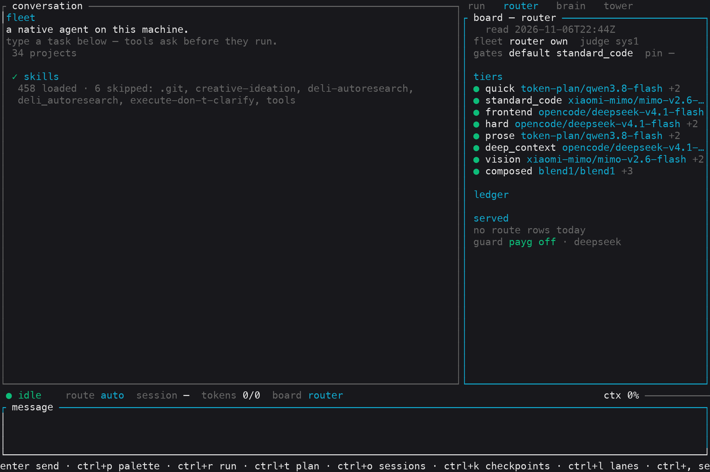
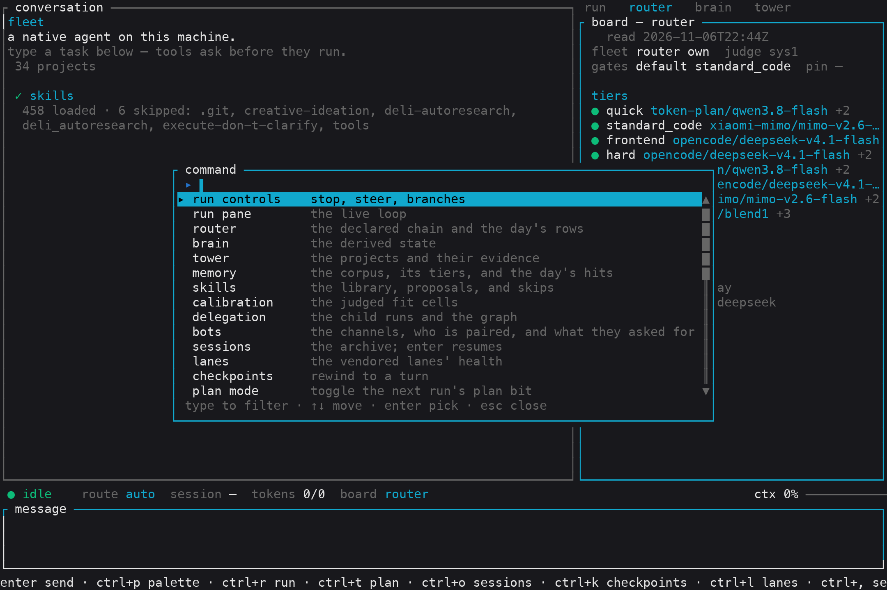
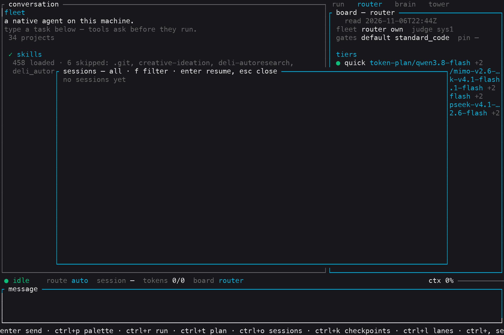
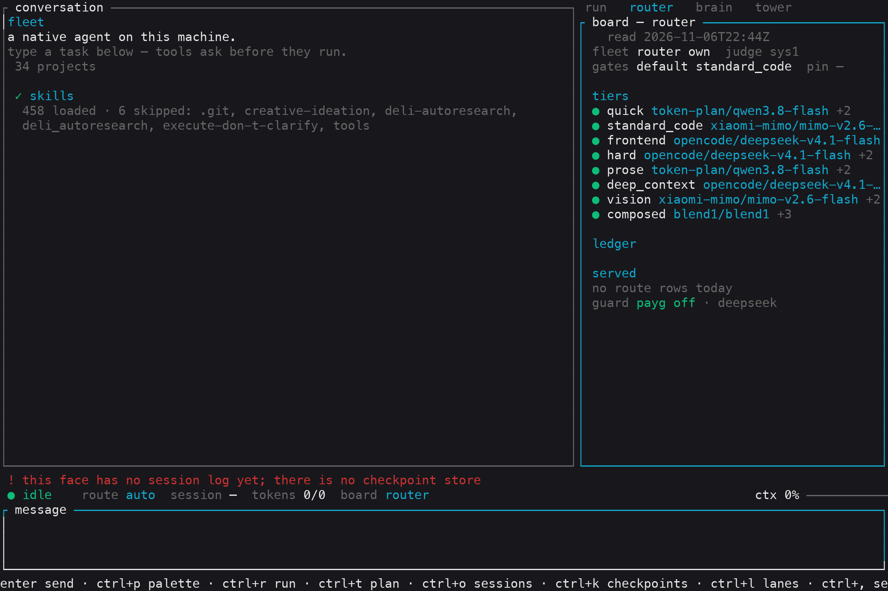
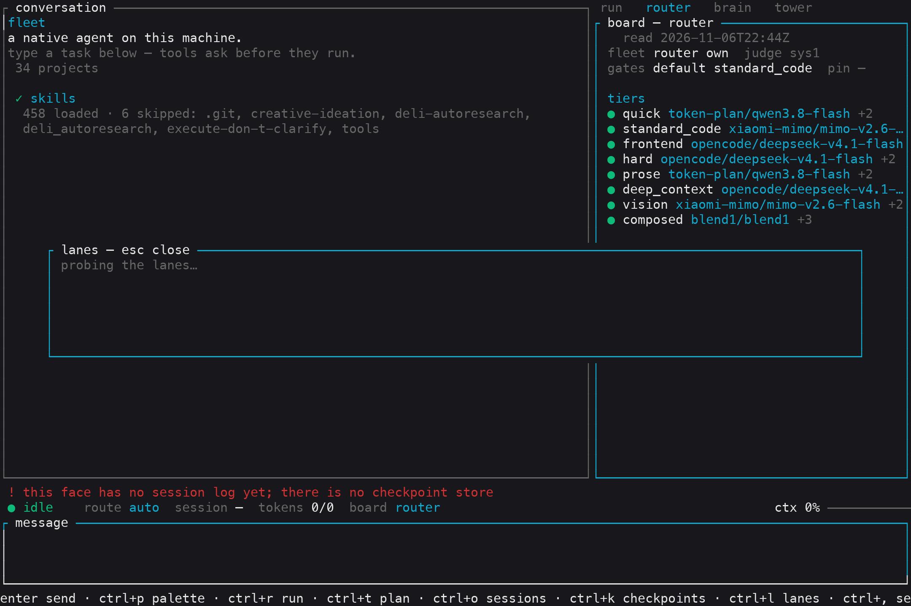
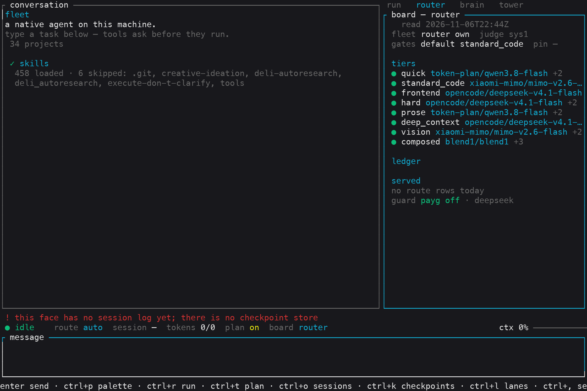
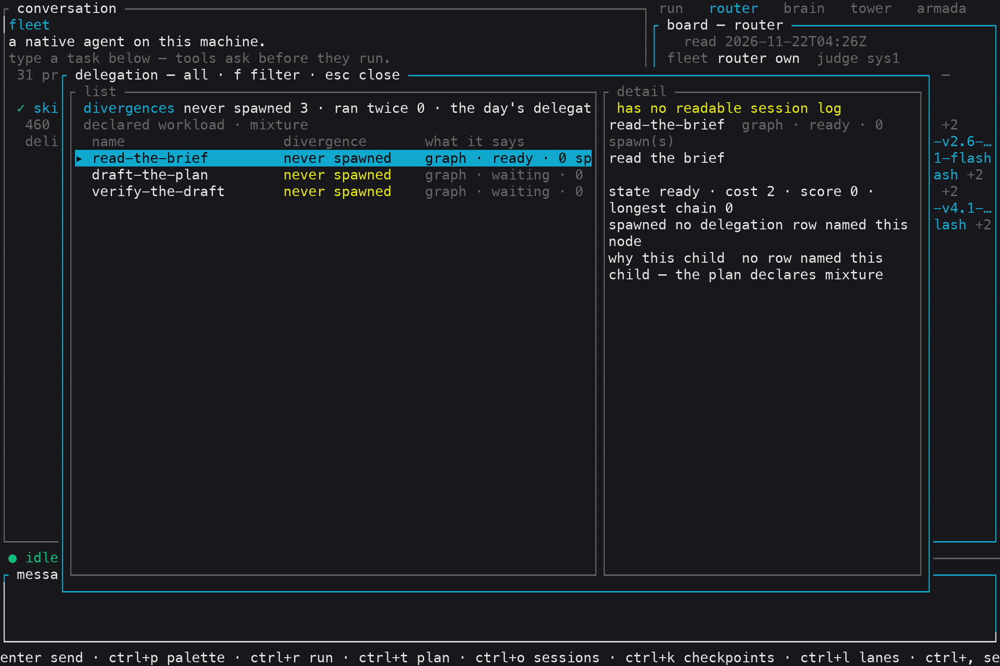
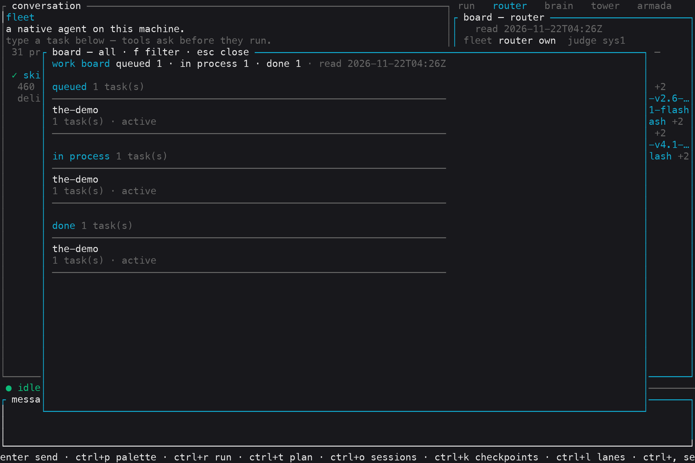
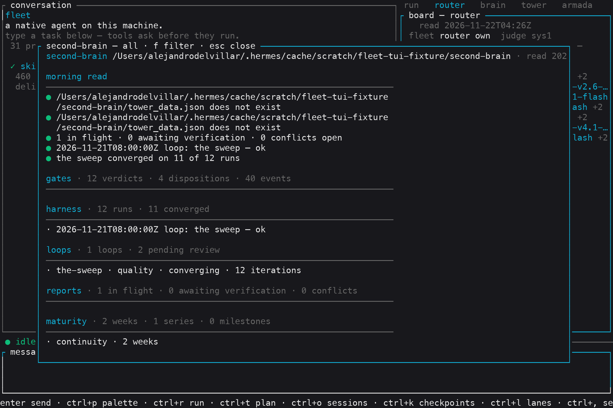

# The terminal face — `fleet`

`fleet` with no subcommand is the ratatui surface over the same agent
core the CLI and the browser face drive. It is keyboard-first and
denser than the browser: the conversation is the center, and the right
pane is a tabbed run card and board set rather than a dock.

Shots at 120×40 from a scratch home — `scripts/tui-shots.py` drives the
face in a tmux pane, captures each screen with its colours, and renders
it beside the browser face's surfaces.



*the conversation: the run's board beside the transcript, the status bar
reading context health*



*the palette: every pane, panel, and action, filtered by typing*



*sessions: the archive as a styled table — a fresh home names its
emptiness*



*checkpoints: the turn table; enter arms a rewind, `d` opens the diff —
a fresh home has no store yet, and says so*



*lanes: the vendored lanes' health, probed live*



*plan mode: `Ctrl-T` holds the write-class tools; the plan is the final
answer*



*delegation: the declared graph with the day's rows joined onto it — the
divergence column, the graph's counts, and why-this-child on the
selected node*



*board: the three derived columns as card stacks — queued, in process,
done, each with its own count*



*second-brain: the morning read's five sentences and the six derived
state sections — a section that did not land names its file*

## The shape

At 120 columns the frame is the conversation on the left and a tabbed
pane on the right (`run router brain tower`), with a status bar, a
message box, and a footer of keys. Below 80 columns the right pane
folds into a one-line run strip above the message box; the conversation
keeps the width.

```
┌ conversation ──────────────────────────────┐ run  router  brain  tower
│ you  build the tui revamp                  │ ┌ the run ──────────────┐
│ fleet  Starting with the shell.            │ │ in flight  0:42       │
│ ✓ bash  cargo test  done                   │ │ ◉ act  bash · 3 calls │
│                                            │ │ gate on · sys1        │
│                                            │ │ branches 1            │
│                                            │ │ ● 3f2a1c  done        │
│                                            │ │ [s] stop  [i] steer   │
├────────────────────────────────────────────┴─┴───────────────────────┤
│ ● idle  route auto  12.4k tok  ctx 38%                      pane run │
│ ▍ message                                                            │
│ Enter send · Ctrl-P palette · Ctrl-R run · Ctrl-T plan · q quit      │
└──────────────────────────────────────────────────────────────────────┘
```

The status bar's context gauge is a `LineGauge` fed by the last
streamed `usage` event; the conversation has a `Scrollbar`; the boards
use the tab row as their title. The palette and the tables are the only
surfaces that need their own state (`ListState`/`TableState`). The bar
carries the state, the routing mode, the session, the token counts and
that gauge — and no turn ordinal (the 2026-11-05 ruling): a run on its
seventh turn draws the same bar as one on its first, and `status.turn`
stays because the cap, the log and the checkpoint paths read it, not
because the owner does.

## The composed boards

The router and tower boards are not one paragraph of hand-built lines.
Their data gets geometry:

- **Router.** The busiest hours of the day as a horizontal `BarChart`
  (hour label, calls, bar); the day's served rate as a `Gauge`; the
  model mix as a second `BarChart` when more than one model took a call;
  then the tier chains, the ledger, the served rows, the judge split,
  the workload mix, the payg guard, and the guidance as composed lines.
  The ledger is above the served rows so a short pane truncates the
  list, not the counts, and the tail is always named with `+N more`.
- **Tower.** The reports-by-day series from the brain board's
  `reports.report_daily` as a `Chart`, and the commits series from
  `tower.timeline` as a `Sparkline` on its own scale — a shared axis
  would flatten commits into the baseline. The top six projects by
  thirty-day commits are a horizontal `BarChart`; the existing
  two-line project cards carry branch, dirty/ahead/behind, and the head
  subject below them.
- **Lanes.** The lane health view is a `Table` with lane, role, state,
  tools, and version/latency columns; the selected lane's tool names
  and blend1's doctor sub-lanes are spanning rows underneath, and a
  `Scrollbar` marks an overflowing list.

The charts are fed by the snapshots the boards already read; the tower
composes from the brain slot rather than adding a read. At 80×24 the
router charts collapse to the lines and the tower keeps only the project
bars and cards; the chart is omitted, never drawn empty, when the brain
slot has not landed or refused.

## Modes

| Mode | What it is |
|---|---|
| Chat | typing, streamed tokens, tool cards, the plan card |
| Run | the stop, the steer, and the branch cursor |
| Steer | the one-line steer editor inside Run |
| Palette | every pane, panel, and action, filtered by typing |
| Sessions | the archive as a styled table |
| Checkpoints | the turn table; Enter arms a rewind, `d` opens the diff |
| Diff | files and hunks; `r` rejects the hunk, `R` the file |
| Confirm | `y` lands the armed rewind/reject; any other key walks away |
| Panel | memory, skills, calibration, delegation, bots, board, or second-brain — list + detail, or the surface's own cards |
| Approval | the tool call's yes/no/always prompt |
| Lanes | the vendored lanes' health |
| Settings | the scalar knobs (including the spend guard and the spend/runtime env knobs) and both lists, cards not a bare table |
| Explain | today's explanation card |

## The run card and the controls

The card is reduced from the same `UiEvent` log the conversation reads:
route → think → act → verify, the tool, the calls, the facts, the lanes,
the checkpoint, the delegation branches, and the last step. The turn's
ordinal is not among them (the 2026-11-05 ruling): the think step says
"the model's turn", the strip carries no `tN`, and a done branch names
its outcome. The loop's counter stays internal; the checkpoint stays
because it names a rewind target the owner can act on.
The verify step names the failover gate from `route::calibration_config`
(`gate on · sys1` / `gate shut`). A stopped run renders as **stopped by
you**, not a failure: the core reports a stop through `Failed`, and only
the reason string separates the two.

`Ctrl-R` opens the controls. `s` writes `{"stop":true}` and `i` opens
the one-line steer. The writes go through `delegate::write_control`, the
same `<sessions>/<session>.control` file the agent's turn loop reads
before every model call. The latency is one step, the card says
`stopping…` until the run's end record lands, and the control file is
cleared when the run returns so a stop on the last step cannot end the
next run.

## Plan mode

`Ctrl-T` toggles plan mode for the next run. A plan run's final answer
is kept as the plan card; `Ctrl-E` loads it into the message box, where
the owner edits and sends it. The TUI never submits a plan on its own.

## The palette and the direct keys

`Ctrl-P` opens the palette. Every letter filters (including `j` and
`k`, which are not movement here); ↑/↓ move; Enter performs the chosen
action. The direct keys remain: `Ctrl-O` sessions, `Ctrl-K`
checkpoints, `Ctrl-L` lanes, `Ctrl-,` settings, `Ctrl-X` explain,
`Ctrl-B` cycle the pane, `Ctrl-R` run controls, `Ctrl-T` plan, `Ctrl-E`
load the plan, `q` quit from an empty prompt, `Ctrl-C` always quits.

## The trust trio

- **Checkpoints** are read from the home's `checkpoints` store. Enter
  on a turn arms a rewind; `y` restores the tree, appends the `rewind`
  record, cuts the log at it, reseeds the view, and drops the cached
  route in the agent thread.
- **Diff** re-reads the tree against the selected checkpoint. Each hunk
  is shown with its old/new lines; `r` arms a hunk reject and `R` arms
  the whole file. A reject re-derives the diff before writing, then
  re-reads it, so the panel shows the tree as it now is.
- **Plan mode** is the fourth trust-trio capability and lives above.

Every trust write is confirmed with the sentence naming what it puts
back; there is no unconfirmed destructive key.

## The knowledge panels

The palette opens memory, skills, calibration, delegation, bots, board, and
second-brain. Each is an on-demand read on its own thread — the library scan
and the archive replay are too heavy for the 30-second board cadence — and each
renders a list on the left and a detail column on the right (stacked below 100
columns). `f` cycles the panel's own filter:

- memory: all / live / protected / retired
- skills: all / used / unused / proposals / skipped
- calibration: all / fit / informing
- delegation: all / live / history
- bots: service / peers / pending / activity
- board and second-brain: one view (their surfaces are the document itself)

The rows are the substrate's own reads (`boards::read_memory`,
`read_skills`, `read_delegation`, `calib::read_day` + `calibration`),
not a second derivation — and the bots panel reads the same three files
the browser's `#/bots` reads (`channels/status.json`, the two stores,
and `activity.jsonl`), so the two surfaces cannot disagree about who can
reach the fleet. A read that fails lands a named note in the panel; a
read that finishes after the panel closed is dropped by the generation
stamp.

The bots panel does not start or stop a channel, and says so in its
service view: a port belongs to the process that holds it, and the TUI
is not that process. Start and stop live where the service is hosted —
`fleet gui --channels`, or `channels.enabled` in the settings.

### Delegation, the graph half

The delegation panel draws the live tree and the archive it always drew, and
now the face's declared graph beside them. The graph rows come from the same
document `bridge::delegation_read` serves: `boards::read_delegation` for the
graph, then the day's `OP_DELEGATION` rows joined onto its nodes by
`boards::delegation_overlay`, plus `boards::declared_workload` for the plan's
own verdict — the same two functions the face calls, so the terminal cannot
say a node ran twice when the face says it ran once.

Each graph row's third column is the overlay's divergence word (`never
spawned`, `ran twice ×N`), clipped through `cards::clip` at the column's
width budget — elided, never dropped. The selected node's detail card carries
why-this-child: the plan's declared workload, the brief's shape, the
provider, and the outcome, each omitted when the row did not record it. A
node no row named says so (`no row named this child — the plan declares
…`) rather than passing the declaration off as a run. The list's tile carries
the graph-level divergences and their evidence basis (`the day's delegation
rows`). The divergence column exists only when the document joined: with the
graph half absent the column is absent by name, and the tree half still
draws.

### The board

The board panel is the face's work board at a keyboard's density. It reads
`boards::read_work_board` — the one derivation both faces consume: every
approved plan's graph (a draft never contributes work) plus the owner's
ad-hoc tasks, with the bridge's own `queued` / `in-process` / `done` words.
The panel derives three columns from that one read and draws each as a card
stack in the 72-cell frame: the column's heading and its own count, a
`cards::rule` line, then one card per plan carrying the plan's name, how many
of its tasks stand in this column, and the plan's state word. The count strip
at the top is those same columns' counts — never a second derivation.

A column with no cards is not drawn; the strip still carries its zero because
a count is a count. An empty board names itself (`no plan carries work right
now`) and prints the read's refusal (`… holds no approved plan — a plan
contributes work once it is approved`). A zero dressed as a column is the
defect the face already fixed, and the terminal does not reintroduce it.

### The second brain

The second-brain panel is named for what it reads: the face's
`#/second-brain` document, through the same home resolution
(`SECOND_BRAIN_HOME`, then `~/.second-brain`) and the same six-file
`boards::read_brain`. It is not the memory panel and does not merge with it —
the corpus and the derived state stay apart, as they do in the face.

The morning read leads the card stack: five sentences derived from that one
document, with the face's own rules — the attention queue's total and its
four counts; the queue's first row in its own words; the reports file's
in-flight / awaiting-verification / conflict counts; the harness log's newest
event; and the loops' newest finding, or the review they owe, or the quiet.
A section that did not land prints that section's own refusal sentence
(`harness_state.json does not exist`) where its counts would stand — never a
zero. Below the morning read, each of the six sections prints its count line
and its own rows (gates and their graded progress, harness runs and
convergences, loops and pending reviews, reports and the feed, maturity
weeks and series, the tower's projects).

Both new surfaces draw through `cards.rs` (`CARD_WIDTH = 72`, escape-aware
`fit`, `clip`, `rule`), so a long plan name or refusal wraps or elides
visibly rather than silently dropping its tail.

## Widgets and the contract

Only the already-declared `ratatui 0.30.2` is used. The revamp added
`Tabs`, `Table`/`TableState`, `LineGauge`, `Gauge`, `BarChart`, `Chart`
with `Axis`/`Dataset`, `Sparkline`, `Scrollbar`/`ScrollbarState`,
`List`/`ListState`, and `Cell`/`Row`; the settings and the project cards
keep their hand-composed cards, because that is what reads best at
their widths. No crate was added, so the one-static-binary contract is
unchanged.

The 0.30 traps are respected: both gauges clamp their ratio, the
scrollbar is drawn only when the content overflows, the chart's axis
labels are edge labels at 42 columns, and the deprecated
`Table::highlight_style`, `LineGauge::line_set`, and
`LineGauge::gauge_style` are not used.

## Verification

The state machine and key mapping are tested without a terminal; the
renderer uses `TestBackend` at 120×40/42, 80×24/25, and a 20×20
does-not-panic case, asserting the rendered text and, where precision
matters, the buffer cells and cursor. The board tests pin the charts at
the wide size and their collapse at 80×24. A live terminal pass in tmux
covers the run card, stop/steer, plan mode, the palette, sessions,
checkpoints, the diff and confirm, every knowledge panel, and the
composed boards.
